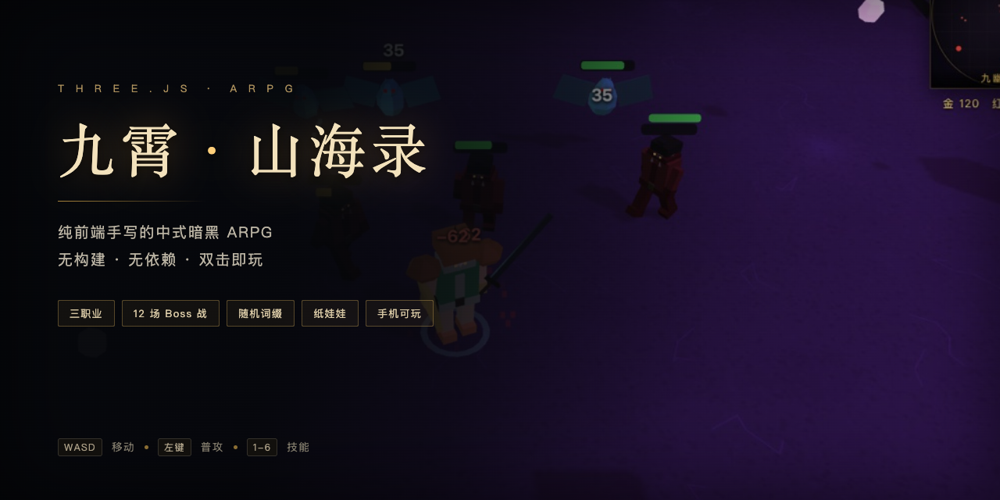
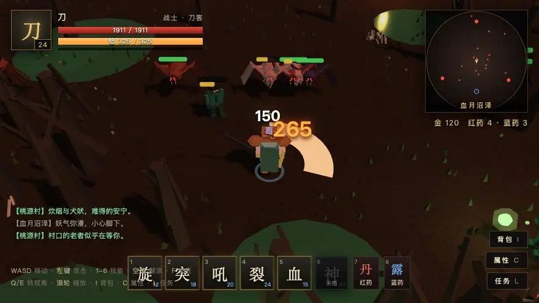
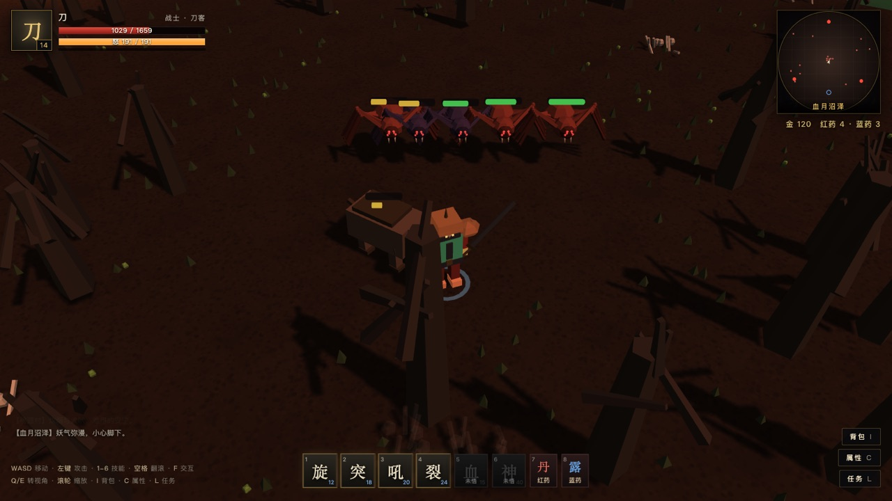
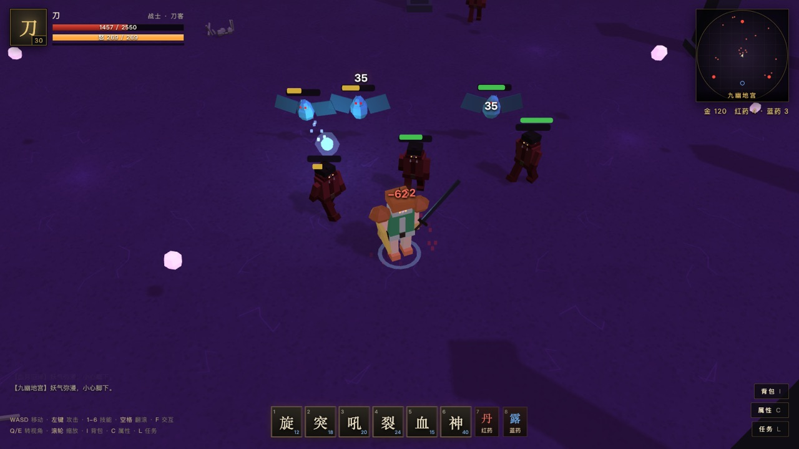
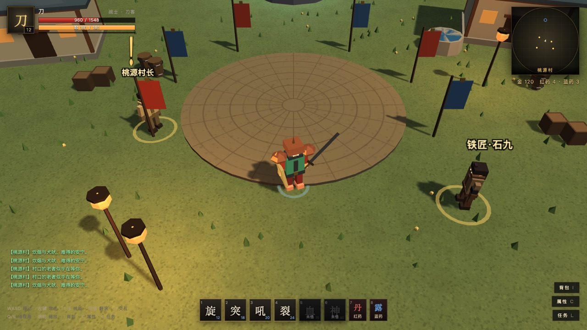
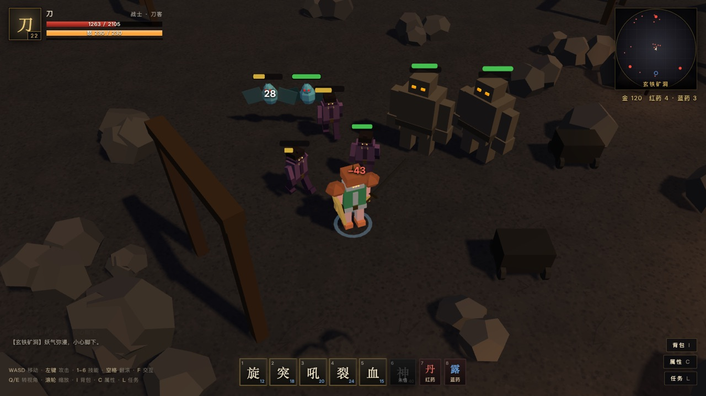
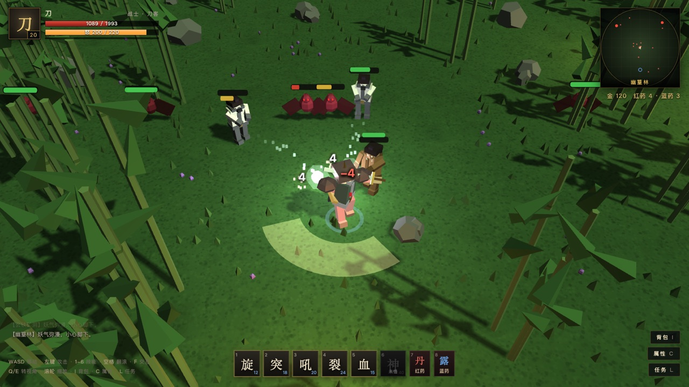
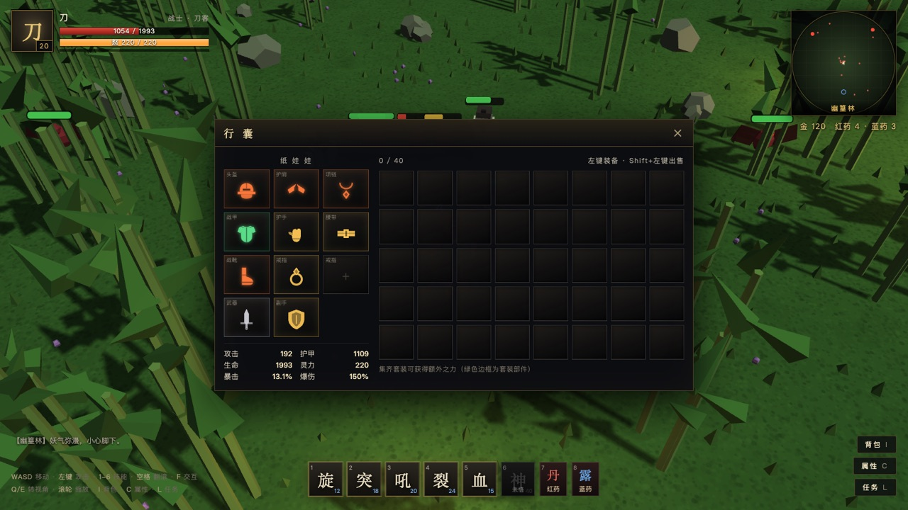
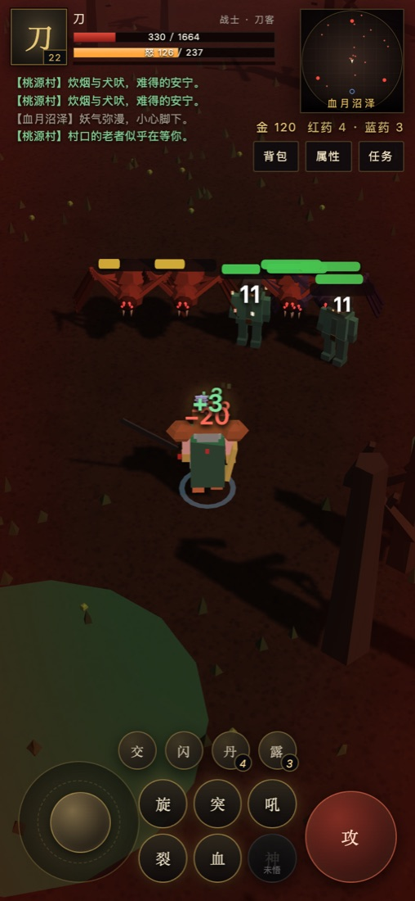

<div align="center">



<br>

### 用 three.js 从零手写的 3D 中式暗黑 ARPG
**无构建 · 无依赖 · 双击即玩 · 手机可玩**

<br>

[](https://718997675.github.io/jiuxiao-arpg/)
[](LICENSE)
[](https://threejs.org/)
[](.)
[](.)

<br>

三职业 · 12 场 Boss 战 · 12 个装备位（含**法器 30 件**，各带介绍·来历·术法联动·专属器物图标）· 64 条随机词缀（固定 / 可洗两类 · 按职业与部位差异化 · 等级成长 · 稀有惊喜）· 9 套职业套装（3 类型 × 3 职业，5/4/3 件）· 单手 / 双持 / 双手三系握持 · **匠材打造（9 种匠材 · 5 档配方 · 白装 / 蓝装重铸更高品质）** · 行囊四栏**图标化 + 数量角标**（装备 / 材料 / 丹药 / 任务物品）· **行囊扩容 8 档（40 → 104 格）** · **八页签主菜单（Tab）** · 24 符文 / 12 符文之语 · 玄晶四级 · 装备强化 / 分解 · 传送石 · 四档难度 · 120 天赋节点轮盘（随等级开放）· 36 术法 × 108 变体 · 5 格自定义技能条 · 36 枚象形技能图标 · 古风角色纸娃娃换装（按身体朝向落位）· 程序化建模零素材

</div>

---

## 这是什么

一个**完全用代码画出来**的 ARPG：没有一张图片素材、没有一个音频文件、没有一次模型加载。

地面是 Canvas 程序化生成的纹理，角色和怪物是代码拼的几何体，音效是 WebAudio 现场合成的波形。整个项目 29 个 JS 文件、约 1.7 万行源码，用 `file://` 双击就能玩，也能直接丢到任何静态服务器上。

| | |
|---|---|
| **引擎** | three.js r128（本地内置，不用 CDN） |
| **形态** | 纯静态，零构建，零 npm 依赖 |
| **操作** | PC 键鼠 / 手机虚拟摇杆，自动切换 |
| **存档** | localStorage + 内存兜底，异常不黑屏 |
| **体积** | 源码约 1.2 MB（含 three.js） |

## 画面

<div align="center">

<br>
<sub><b>实时战斗</b> · 挥砍时刀光横扫、怪物受击白闪、伤害数字弹出、击杀后顿帧。<br>（若不动，<a href="docs/screenshots/demo.gif">点这里看 GIF 版</a>）</sub>
</div>

<br>

<table>
<tr>
<td width="50%"><br><sub><b>血月沼泽</b> · 精英怪带黄色光环，头顶血条随距离淡出</sub></td>
<td width="50%"><br><sub><b>九幽地宫</b> · 28 级区域，怪物密度显著提高</sub></td>
</tr>
<tr>
<td><br><sub><b>桃源村</b> · 安全区，NPC 与任务集散地</sub></td>
<td><br><sub><b>玄铁矿洞</b> · 狭窄地形，怪物容易形成包夹</sub></td>
</tr>
<tr>
<td><br><sub><b>打击感</b> · 弧形刀光、顿帧、击退、暴击数字</sub></td>
<td><br><sub><b>纸娃娃</b> · 17 种装备图标，穿戴后模型实时变化</sub></td>
</tr>
</table>

<div align="center">

<br>
<sub><b>手机端</b> · 左摇杆移动，右侧 3×2 技能宫格，自动瞄准最近敌人</sub>
</div>

---

## 一、运行方式

- **推荐**：双击 `index.html`（Chrome / Edge / Safari 均可）。
- 若浏览器限制本地文件，可在目录下起一个静态服务：

```bash
python3 -m http.server 8000
# 打开 http://localhost:8000
```

进度自动保存在浏览器 `localStorage`（**十个角色位** `jiuxiao_save_v2_s1` ~ `s10`，V1 旧档会自动迁移），标题界面可「继续前世」。

---

## 二、操作

| 操作 | 按键 |
| --- | --- |
| 移动 | `W A S D` / 方向键 |
| 普攻 | 鼠标左键（按住连击） |
| 技能 | `1` ~ `5`（技能条 5 格，自己配；右键 = 第 1 格） |
| 翻滚（有无敌帧） | `空格` |
| 交互（NPC / 传送阵） | `F` |
| **主菜单（八页签）** | **`Tab`** |
| 行囊 | `I` |
| 道途（属性） | `C` |
| 天赋 | `T` |
| 术法 | `K` |
| 山海志（任务） | `L` |
| 炼器台（锻造 / 符文 / 洗练 / 强化） | `R` |
| 存档管理 | `P` |
| 设置 | `O` |
| 旋转视角 / 缩放 | `Q` `E` / 滚轮 |
| 喝药 | `Z` 红药 · `X` 蓝药 |
| 使用传送石 | `9` |
| 关闭面板 | `Esc`（先关菜单，再关其它浮层） |

八个面板现在收在**一个主菜单**里：左侧一排页签（行囊 / 道途 / 天赋 / 术法 / 山海志 / 炼器台 / 存档 / 设置），右侧只挂当前这一页，HUD 上只留「行囊」与「菜单」两个按钮。上面每个快捷键仍然是直达对应页签，`Tab` 开合、`Esc` 逐层退出。

行囊内：**左键装备 / 卸下**，**Shift + 左键出售**。行囊分**装备 / 材料 / 丹药 / 任务物品四栏**（点栏头切换）：**左列是装备栏**（按身体朝向落位的纸娃娃 + 下方常驻的人物详细属性，超出就列内滚动），**右列是行囊与各栏位**，底部带一张行囊概览卡（容量进度、品质分布、套装之力）。后三栏一律**图标 + 数量角标**——材料一格一种（四阶玄晶、九种匠材、持有符文各带自己的图形），丹药点一下即服用，任务物品按已完成委托生成凭证且不占格位；鼠标悬停（触屏点按）看名称、来源与用途。装备栏顶部另有**一键分解**（批量把凡品 / 法器装备分解成玄晶，带镶嵌的会自动卸下符文再分解）与**套装图鉴**（9 套套装按职业分组，部件清单、已集进度与加成档位）。

### 手机 / 平板

用手机或平板打开会自动切换成触屏界面（PC 打开仍是键鼠界面，互不影响）：

| 操作 | 触屏方式 |
| --- | --- |
| 移动 | 左下角虚拟摇杆（推杆幅度决定速度） |
| 普攻 | 右下角大「攻」按钮，按住连续攻击 |
| 技能 | 「攻」左侧 3×2 宫格（前 5 格 = 技能条，空位点开术法面板配置） |
| 自动瞄准 | 普攻与技能自动锁定 15 米内最近的敌人 |
| 翻滚 | 双击摇杆，或「闪」按钮 |
| 喝药 | 「丹」「露」按钮（角标显示剩余数量） |
| 交互 | 「交」按钮，靠近 NPC / 传送阵时变绿 |
| 转视角 / 缩放 | 拖动画面空白处转视角，双指捏合缩放 |
| 面板 | 右下「行囊」「菜单」两个按钮：菜单里是横排页签（行囊 / 道途 / 天赋 / 术法 / 山海志 / 炼器台 / 存档 / 设置）；物品点一下出详情，再点「穿 戴」或「出 售」 |

横屏、竖屏都做了适配，竖屏时镜头会自动拉远，避免角色占满屏幕。

---

## 三、内容规模

### 三个职业（中国风）

| 职业 | 定位 | 资源 | 核心机制 |
| --- | --- | --- | --- |
| **战士 · 刀客** | 近战爆发 | 怒气 | 普攻积攒怒气，愈战愈勇；旋风斩、烈焰突刺、裂地震击、剑神降世 |
| **法师 · 术士** | 远程爆发 | 灵力 | 火球、冰霜新星、雷弧链、炎爆、玄冰护盾、陨星天火 |
| **道士 · 符师** | 持续/召唤/自愈 | 道力 | 五雷符、召灵狼、回春咒、蚀骨毒雾、太极玄阵、万剑归宗 |

每个职业 **12 个主动技能**（每系 4 个，按 1 / 4 / 8 / 12 / 14 / 18 / 22 / 26 / 30 / 34 级起逐批领悟，压轴技能 38 / 40 级）；每个技能带 **3 个变体**（只修正冷却 / 伤害 / 消耗 / 范围 / 数量 / 持续，随时切换不花钱）；技能可耗技能点升至 **10 级**（每级伤害 +8%，满级 1.72 倍）。部分主线任务还奖励**技能书**，完成后直接领悟对应技能。技能受冷却缩减、技能伤害词缀、天赋与套装修正影响。

### 十二场 Boss 战

| 地图 | 推荐境界 | 首领 |
| --- | --- | --- |
| 幽篁林 | 1–8 | 巨木妖王、血蝠魔君 |
| 血月沼泽 | 8–16 | 半兽人酋长·碎骨、石甲巨魔、蛇姬·青鳞 |
| 玄铁矿洞 | 16–24 | 幽魂道尊、赤炎魔将、冰魄妖后 |
| 九幽地宫 | 24–32 | 万毒蛛母、冥河渡者、天罡剑魂 |
| 天阙残境 | 32+ | 混沌·无相天魔（终局） |

Boss 拥有 **地面预警圈 / 弹幕环射 / 冲撞 / 召唤小怪 / 毒雾 / 冰环 / 剑雨 / 落石** 等 12 类技能，血量低于 60%、30% 会进入狂暴阶段（增伤、提速、缩短技能间隔），死亡 75 秒后重生。

### 装备与词缀

- **12 个装备位**：头盔、战甲、护肩、护手、战靴、腰带、项链、戒指 ×2、武器、副手、**法器**。纸娃娃按身体朝向落位（头中上、护肩左上、法器右上、战甲居中两行、战靴在下、武器与副手在底部左右两条长格），格子大小随部位分四档。
- 5 档品质：**凡品（白）/ 灵品（蓝）/ 玄品（金）/ 神兵（橙）/ 套装（绿）**。
- **64 类随机词缀**，前缀 + 后缀组合命名，数值随物品等级成长。例：`残虐的青龙战甲·避劫`。
- 武器按职业区分（剑/刀/斧/偃月刀、法杖、桃木剑/七星剑…），并有 **6 件唯一神兵** 附带特效（连锁天雷、击杀爆炸、霜寒减速、吸血等）。
- **9 套职业套装**（v1.2.2，3 类型 × 3 职业，件数 5 / 4 / 3）：每个职业三条完全不同的构筑路线，效果全部对着**当前技能与天赋**设计，而不是泛泛加属性。

  | 职业 | 5 件 · 主套 | 4 件 · 兵装套 | 3 件 · 随身套 |
  | --- | --- | --- | --- |
  | 战士 | **龙骧**（突进）：烈焰突刺 +80%、跃击 +30%、突进距离 +30%；5 件冲撞命中 3 人立刻刷新突刺、剑神 +50% | **磐石**（守护）：护甲/格挡/减伤 + 荆棘；**格挡即反击** 150% 护甲伤害，盾墙期间翻倍 | **血怒**（暴击）：暴击叠「狂怒」5 层（每层 +5% 伤害 / +4% 攻速），斩杀对残血 +40% |
  | 法师 | **星阙**（烈焰）：火球 / 炎爆 / 火墙范围 +30%、消耗 -12%；5 件陨星 +8 且火球留下火海 | **雷殛**（雷霆）：雷弧链 +2 跳、雷罚 +40%；**技能暴击追加天雷** 波及其他敌人 | **玄冰**（冰控）：冻结 +8%；**被减速 / 冻结的目标受伤 +25%**，暴雪 +2 秒 |
  | 道士 | **青符**（召唤）：灵狼继承 90%、一次召 2 头、万剑 +6 道、毒雾更大更久 | **丹鼎**（毒煞）：持续伤害 +30%；**毒雾每跳 25% 概率爆裂**，毒雾更大更久 | **天师**（符箓）：五雷符 +40%、符箭 +2 张并穿透；**对中毒 / 燃烧目标 +40%** |

- **两条成型路线**（部位刻意错开，凑得起来也换得掉）：
  - **9 格满配**：主套 5 件（盔/甲/肩/手/靴）+ 兵装套 4 件（武器/副手/腰带/项链）＝ 9 格全部占满，两套核心档同时点亮。
  - **三套混搭**：随身套 3 件（护手/腰带/项链）+ 主套 4 件 + 兵装套 2 件 ＝ 9 格，三套低档叠加；用主套的 5 件档换三套的机制组合。
- 套装件的**词条取向逐套不同**（`set.sig`）：龙骧偏攻击 / 移速、磐石偏防御 / 格挡、玄冰偏冻结 / 减速，保底一条本套标志词条；部位词条池禁掉的取向自动回落到本职业取向。套装效果走与传世 / 天赋同一条 `skillMods` 通道，并新增 `specials` 数组支持一档点亮多个机制（青符：灵狼质变 + 双狼同开）。
- 旧档迁移：6 件套时代留下的**套装武器**已不在新目录内，读档时剥离套装标识、降为玄品，词条 / 孔位 / 符文全部保留。

### 行囊扩容（v1.4.0）

行囊从 **40 格**起，可一路扩到 **104 格**：8 档、每档 +8 格，永久生效并随存档保存。

- 入口在装备栏提示行右端的「**扩 容**」；点开在行囊内展开一条**乾坤囊**，不弹窗、不挡格子。
- 条内直接写清 `当前 → 下一档` 容量、档位点阵（8 颗，已过实心 / 当前亮）、以及每项消耗的 **拥有 / 需要**——够是绿色，不够转红并写明「还差：凡晶、铜钱」。
- 消耗是**四阶玄晶 + 铜钱**，逐档递增；**首档只要 12 枚凡晶 + 300 铜钱**，新号做完两趟委托就能扩第一次。
- 确认后当场生效：容量数字与格子同时变多，多出来的空位立刻能放东西；满档时入口转为灰态「已 满」，条内改为「已达上限」。

| 次数 | 容量 | 凡晶 | 灵晶 | 玄晶 | 神晶 | 铜钱 |
| --- | --- | --- | --- | --- | --- | --- |
| 1 | 40 → 48 | 12 | — | — | — | 300 |
| 2 | 48 → 56 | 24 | 3 | — | — | 800 |
| 3 | 56 → 64 | 36 | 8 | 1 | — | 1,600 |
| 4 | 64 → 72 | 50 | 14 | 3 | — | 2,800 |
| 5 | 72 → 80 | 70 | 22 | 6 | 1 | 4,500 |
| 6 | 80 → 88 | 96 | 32 | 10 | 2 | 7,000 |
| 7 | 88 → 96 | 130 | 46 | 16 | 3 | 10,000 |
| 8 | 96 → 104 | 180 | 64 | 24 | 5 | 14,000 |

未扩容时行囊铺满 **40 格**（5 行），扩容后铺满整行容量——格子数**永远等于容量**，扩容的收益是一排看得见的新空位，而不是一个虚数字。

### 装备栏布局（v1.5.0）

行囊面板分成明确的两列，不再是一张长表：

- **左列 = 装备栏**：标题「装备栏」+ 按身体朝向落位的 12 个装备位 + 下方**常驻的角色属性**（根基 / 攻伐 / 守御 / 续航 / 机能五组，与属性面板同源）。属性条数超出左列可用高度时**在列内滚动**，切到材料 / 丹药 / 任务物品栏也照旧显示。
- **右列 = 行囊与各栏位**：容量与排序条、四栏页签、行囊格子（或材料 / 丹药 / 任务列表），底部是**行囊概览卡**——容量进度条、所持品质分布、套装之力进度与操作提示，正好吃满格子没占完的高度。

桌面端两列各自滚动、面板高度固定；触屏改成整面板滚动（手机屏矮，硬切两列会把一边压成一条缝）。

### 行囊图标化 · 八页签主菜单（v1.6.0）

四个栏位不再是一行行文字，而是**一格一物**：

- **材料栏**常驻 13 格——四阶玄晶（凡 / 灵 / 玄 / 神）+ 九种匠材（玄铁锭、妖兽皮、妖骨、灵蚕丝、赤炎砂、寒玉髓、玄鳞、陨星铁、妖丹），不持有的也留格并灰显，让「还差什么料」一眼可见；持有什么符文就追加哪些符文格。
- **丹药栏** 3 格（红药 / 蓝药 / 传送符），**任务物品栏**按完成的委托各生成一张凭证格，左上角带委托序号。
- 数量统一走**右下角角标**（≤999 直显，再多写 `999+`），格子底色按材料自己的颜色起径向渐变、底边压一条同色实线，图标是 32×32 的 `<path>` 矢量（`src/data/data-mat-icons.js`，17 枚：材料 / 玄晶 / 丹药 / 凭证），缩到 20px 仍然认得出。
- 悬停（触屏点按）弹名称、来源与用途。

**主菜单**把原来那八个各自开浮层的入口收成一个外壳：左侧竖排页签（行囊 / 道途 / 天赋 / 术法 / 山海志 / 炼器台 / 存档 / 设置），右侧只挂当前页，HUD 从 8 个按钮减到 2 个（行囊、菜单）。实现上是**搬 DOM**——把原面板 `appendChild` 进菜单容器并加 `.embed`，关菜单再送回原籍，所以各面板的布局、事件、探针选择器全部原样复用，不必为「嵌入模式」重写一遍。触屏上页签翻成顶部横排可横滚，内容区整块滚动。

### 匠材与打造（v1.6.0）

**匠材**是怪物与 Boss 掉的新材料，不占行囊格（与玄晶、符文同库，落在地上是一枚带淡光柱的八面体，走过去自动拾取）：

| 档 | 匠材 | 来源 |
| --- | --- | --- |
| 凡料（一档） | 玄铁锭 · 妖兽皮 · 妖骨 | 低阶区域遍地都是，普通怪就有 |
| 灵料（二档） | 灵蚕丝 · 赤炎砂 · 寒玉髓 | 精英怪必出，高阶普通怪偶尔 |
| 神料（三档） | 玄鳞 · 陨星铁 · 妖丹 | 只在 Boss 身上 |

**打造**在炼器台新增的「锻造」页：选一件**白装（凡品）或蓝装（灵品）**当胚，配上若干匠材与铜钱，重铸成同部位、同等级、同职业的更高品质装备。

- **5 档配方**贴着基底等级走（1–8 / 9–16 / 17–24 / 25–32 / 33–40），每档换料、加价：铜钱 400 / 1,200 / 2,600 / 4,800 / 8,000。
- **底子越好越省料**：蓝装胚按 6 折收匠材与铜钱（每种至少 1 个）。
- **兵刃另加料**：武器与副手额外要**玄鳞 + 陨星铁**——甲可以省，刀不能省。
- **成品品质**：白装胚 100% 出蓝装；蓝装胚 62% 玄品 / 26% 神兵 / 12% 套装。**不产法器**（法器只能掉），套装件保留原有套装体系。
- 界面把「胚 → 成品概率」画成一条箭头，下面是需求格：够的写 `拥有 / 需要`，不够整格描红，按钮置灰并在下面直书「还差：赤炎砂、玄鳞」。扣料扣钱与重铸在同一次结算里，重铸失败（异常）自动退还。

### 兵器握持（v1.3.0）

每个武器档位（3 职业 × 5 档）都恰好一件**单手 / 双持 / 双手**，由同档三变体的单次均伤派生（最轻 = 双持、居中 = 单手、最重 = 双手）。

| 握持 | 规则 |
| --- | --- |
| **单手** | 副手可配盾 / 珠 / 符 |
| **双持** | 主副手各持一把；主手已满时点行囊里的双持武器会直接补到副手 |
| **双手** | 占用副手位，装上时自动把副手卸回行囊，之后副手格锁定并拒绝穿戴 |

主手卸下时副手那把双持兵器一并收回；异常存档（双手 + 副手并存）由 `repairHands()` 在读档与 `recalc` 前自动纠正。

### 法器（v1.3.0）

第 12 个装备位，戴在纸娃娃**右上角**。三职业各 10 件共 **30 件**，不做随机词条（永远不能被洗练 / 强化），属性与术法修正全部写在目录里。

- **每件都有**一句介绍、一段来历、固定属性，以及**对某门具体术法的修正**——30 件覆盖 30 门不同术法，与 36 术法 × 108 变体一一咬合。
- **附带术法** 4 件（剑神幡 / 天罚朱笔 / 天师印 / 青龙鳞）：**未领悟也能施放，卸下立即失效**。
- 完全随机掉落里占 6%，只出本职业；指定部位或品质的调用不会被顶掉。
- 30 件各有一枚**手绘器物图标**（`src/data/data-relic-icons.js`）：外圈是双环 + 四方芒刺的法阵，内圈是金色剪影 + 暗色开凿的器物本体，在纸娃娃上缓慢呼吸发光，行囊里比普通装备大一号。


### 符文与炼器（S2）

- 装备可带 **0–4 个孔**（戒指与项链无孔），孔数与品质、物品等级相关；不足可用玄晶**打孔**补到 **5 孔上限**。
- **24 种符文**（4 个品阶）镶入后立即生效；单个符文提供小属性，真正的价值在组合。
- **12 个符文之语**：孔数、顺序、全部填满三项同时满足才成立，例如 `艾尔 → 索尔 → 塔尔` 组成「雷霆之语」，普攻 18% 召下连锁天雷。按下 `R` 打开炼器台，点空孔、点符文即可镶嵌，点已镶符文取下并全额返还。
- **装备词条分两类**（v1.1.6）：
  - **固定初始词条**：每件装备按品质自带，**凡品 0 / 灵品 1 / 玄品 2 / 神兵 3 / 套装 2 / 传世 4** 条，再叠加等级成长（12 级 +1、30 级 +2），数值按可洗词条的 **6 折**生成。它们锁定不动，**洗练、强化、改为指定词条都碰不到**，等于这件装备的底子。提示框里带暗金「固定」标签，与下面的可洗词条之间有一条分隔线。
  - **可洗练词条**：掉落的随机词条，洗练 / 强化 / 定向只作用在这一组。两类词条存在两个独立数组里，只在属性汇总时合并，同一件装备不会出现重复属性。
- **词条按职业 + 部位差异化**（v1.1.7）：词条池不是三职业共用一份。
  - **职业**：战士只出力量 / 近战 / 暴击 / 护甲 / 反伤向，**永远不会洗出灵力、法术、召唤、冷却**；法师只出灵力 / 雷火范围 / 冷却 / 护盾，不出力量与近战专精；道士偏毒雾持续、召唤、自愈与技能伤害。掉落时按掉落者职业生成，防具基底本身仍可跨职业穿戴，职业倾向记在 `affixCls` 上。
  - **部位**：武器 / 副手不出纯防御（护甲、减伤、格挡、抗性），六件防具不出武器专精（穿甲、暴伤、斩杀、吸血），项链与戒指只出稀有属性，不出大面积伤害与防御。
  - 基底不绑职业的**通用装备**走三职业的交集池，只出人人都能用的中性词条，避免通用胸甲掉出「力量」而法师穿着没用。过滤后池子不足 10 条时自动放弃过滤，绝不让某个组合的池子枯竭。
  - 传世也参与（v1.1.8 起）：固定 4 条 + 可洗 4 条，叠加等级成长后 40 级可达 12 条，是**全品质词条最多**的装备；原有的 `uniqueStats` 固有属性与传世特性照旧并存。
- **词条数量随等级成长**（v1.1.8）：同一品质下，等级越高词条越多。固定词条在 **12 级 +1、30 级 +2**，可洗词条在 **16 级 +1、32 级 +2**；11 级以内保持旧规则不变。40 级实测：凡品 4 条、灵品 7 条、玄品 9.5 条、神兵 11 条、套装 9.4 条、**传世 12 条**。
- **稀有词条惊喜**（v1.1.8）：任何品质掉落时都有 **12% 概率额外附一条 tier 3 稀有词条**，不占常规名额、不影响强化次数。凡品也能爆出「+15% 格挡率」这种词条，提示框里带金色「稀有」标签。
- **传世 = 最终装备**（v1.1.7）：传世装备改为**红色**标识（品质色、背包格子描边、角色光效同步），它是装备链的终点——不在品质升级链内（无法再往上提），也不带随机词条，强度来自固定属性、传世特性与技能强化。
- **洗练台**：花 **玄晶** 重 roll 单条词缀，稀有度、词缀数量、孔位与已镶符文全部保留；同一件装备每洗一次费用 +35%。
- **定向洗炼 · 单条升级**：洗练页点某条词缀的「定向」按钮，默认进入**升级模式**——每次只动这一条，词条不变、**数值必定高于洗练前的数值，绝不出现下降**；面板显示当前值与本装备等级上限的进度条，封顶后按钮变灰且不再扣玄晶。费用与普通洗练同一套递增规则。
- **定向洗炼 · 改为指定词条**：在升级面板点「改为指定词条」，选目标词条（如暴击率）后点「开始定向洗炼」，即自动消耗玄晶反复洗这一条，直到洗出指定词条立即停止；面板会预告预计次数与总花费，玄晶不足时自动中断、已洗次数不浪费。单次洗练保持原样。
- **玄晶分四级**：凡晶 / 灵晶 / 玄晶 / 神晶，分解装备或精英 / 首领掉落获得；等级越高，洗练 / 强化出的词条品质（1~4 级，字色白→蓝→紫→金区分）越好。
- 符文与玄晶不占背包格，统一进 `stash.mats` 材料仓；精英/首领掉率更高，首领必掉。

自检：`node dev/test-s2.js`（66 项，覆盖数据完整性、孔位分布、符文之语顺序、属性/flag 生效、洗练、旧档归一化、tooltip、9 套均可生成）、`node dev/probe-set-system.js`（103 项，9 套结构 / 档位 / 载体落地 / 词条保底 / 掉落分流 / 打造锁定 / 旧档迁移 / 混搭可行性）、`node dev/probe-fixed-affix.js`（43 项，固定 / 可洗词条拆分与互不干扰）、`node dev/probe-affix-fit.js`（177 项，职业 × 部位词条池、零越界、去重、传世定位）。

### 装备强化 · 分解 · 品质 · 传送石（S3）

- **强化**：与洗练（替换现有词条）不同，强化直接给装备**扩充新词条**，每件最多扩 3 条；消耗玄晶，附加词条同样分品质、按字色区分。在炼器台「强化」页签进行。
- **打孔**：在炼器台「符文」页签，任何装备（戒指/项链除外）都可消耗玄晶开孔，第 1→5 孔分别花 14/20/28/38/50 玄晶，越往后越贵；自然掉落仍是最多 4 孔，第 5 孔只能打出来。
- **材料分解**：桃源村**炼金师·丹朱**处分解装备，按稀有度与物品等级折算成对应等级的玄晶。
- **品质升级**：同一处可消耗玄晶把装备品质往上提（凡品→灵品→玄品→神兵），自动补齐词条、重算基底。
- **套装打造**：同一处「套装」页签，把属性满意的装备打造成**本职业套装**的对应部位——部位自动匹配，跨职业打造会被拒绝；**原有词缀、孔位、已镶符文、强化次数全部保留**，基底按套装档位重算，词缀不足 3 条自动补足。费用：玄晶×10 + 神晶×4 + 金币（随 ilvl 上浮）。传世装备不可打造。
- **传送石**：云游道人处 200 金购买，独立栏位存放；按 `9` 或动作条「阵」按钮使用，直接打开传送面板。
- **出售优化**：铁匠处可「按品质筛选」批量出售；带镶嵌的装备会先自动卸下符文（全额返还）再卖空镶装备。

### 天赋轮盘 · 术法面板（v1.2.0 – v1.2.1）

按 `T` 开**天赋**、按 `K` 开**术法**，两个面板都重做成「一个图标一个图标」的暗黑风。

- **天赋轮盘**：120 个节点排成轮盘——9 个职业系各自放射成枝、大节点压底，通用系「通达」30 个节点首尾相衔成一环。每级 1 点；小节点加属性（5 级）、中节点改机制、大节点是质变（需本系先投 5 点）。节点外圈金弧 = 已投入等级。**洗点** 1k / 5k / 20k / 50k 金币递增；**3 个预设位**可存可切，超点数自动截断，未解锁的节点不会被预设还原。载体与套装同构（stats / skillMods / flag / special），旧档自动补字段、清死 id。
- **天赋随等级解锁**：和技能一样逐步开放——第 2 层 4 级、第 3 层 8 级、第 4 层 12 级、中节点 18 级、大节点 26 级；通用系长链按链上序号（第 1 个 1 级 → 第 30 个 30 级）。没到等级的节点在轮盘上直接标「需 X 级」，点了也只提示，不会白扣点数。
- **术法面板**：36 个技能按系分组的图标网格，点开是详情卡——{dmg} 实时伤害预览、等级菱形 pips、3 个变体钮一键切换。**技能条 5 格，自己配**：详情卡底部 1-5 就是技能条格位，点数字把当前术法放上去，已在条上的会自动换位；已在条上的技能在网格左上角带金色格号。空位点一下也能直接打开面板。
- **36 枚象形技能图标**：旋风、火球、冰环、雷链、五雷符、白虎、青龙……全部是手写 SVG 线性图标，面板 / 动作条 / 手机宫格三处同一套，不再用一个字代替。

### 四档难度与设置面板

- **四档难度**（开始界面选择）：普通 / 困难 / 极难 / 炼狱，分级调整怪物血量、伤害、速度、经验、金币、掉落；极难给无元素怪随机附魔，困难 / 极难下 Boss 提前狂怒。
- **设置面板**（标题界面或游戏内进入）：帧数显示、画质档位、渲染倍率、实时阴影、粒子效果、同屏怪数上限——低配机器也能流畅跑。

### 纸娃娃系统

角色模型由装备实时驱动：

- 古风程序化骨架：交领右衽、广袖、腰封玉扣、发髻束发、甲裙分片、披风、道冠，三职业各自配色（战士朱红墨铁赤金 / 法师靛青月白银 / 道士青碧米白黄铜）
- 头盔改变头饰造型（铁盔 / 道巾 / 法冠）
- 战甲改变躯干配色与金属质感，玄品以上披风、神兵/套装带辉光
- 护肩、护手、战靴独立上色
- 武器按类型换模型（剑、刀、斧、偃月刀、法杖、符剑、盾、灵珠、符箓），刀身/剑身用挤出轮廓而非方块，高稀有度带发光
- 套装 2 件以上脚下出现套装光环
- 纸娃娃面板按身体朝向排布：头中上、护肩左上 / 法器右上、战甲居中两行、战靴在下、武器与副手在底部左右两条长格

### 打击感

普攻/技能命中时的 **顿帧（hitstop）**、**屏幕震动**、**刀光弧**、**受击白闪**、**击退**、**暴击大数字**、**粒子迸溅**、**地面冲击环**、**预警圈脉动**，以及 WebAudio 实时合成的挥砍/命中/暴击/雷击/爆炸/升级音效。

### 声音

- **怪物有族音色**：9 个族群各有音色（人形 / 兽 / 亡灵 / 妖灵 / 石魔 / 草木 / 龙属 / 水属 / 虫群），同一族换事件改音高、时长、亮度与滑向 —— 出手、受击、闲态、察觉、死亡、精英死亡、首领阶段共 7 种。体型越大音高越低，首领一吼比小怪沉一个八度。
- **听得出方位**：HRTF 双耳定位 + 距离衰减，怪在左还是右、在你背后还是正前方都分得清。24 米外不发声，闲态叫声只给 15 米内。
- **四十余只怪同屏不糊**：同时最多 6 路怪声；同族同事件 80ms 内只发一次（狼群齐咬听起来是一声）；预算满时近的顶掉远的，背后的让位给视野内的；闲态每只 6~12 秒一次。首领与阶段转换不受此限。
- **环境音**：六张图各有底噪与随机点缀（风 / 竹叶 / 沼泽气泡 / 矿洞滴水 / 地宫低语 / 天阙钟磬），换图交叉淡出，不会硬切。
- **三层底乐**：探索 / 战斗 / 首领，按地图调式实时演奏、交叉淡入。16 米内有已仇恨的敌人进战斗层，脱战 4 秒后淡回。
- **音量可调**：设置里主音量 / 音效 / 环境 / 音乐四条滑杆 + 一键静音，即时生效且与画质档位分开存；切到后台自动暂停。
- 依然是**零音频文件**：振荡器 + 噪声 + 滤波现场合成。若日后加入录音，按 `<族>_<事件>.mp3` 登记一行清单即自动接管，删掉录音目录游戏照样有声。

### 试炼模式（无限波 · 每波三选一）

村口的**试炼使者·无咎**（`6 级`解锁）把你送上一座悬空擂台：没有关卡、没有终点，只有一波接一波的怪，和每波清场后的三选一。

- **无限波数**：清完一波自动进下一波，波次没有上限。想走随时走 —— 擂台上按传送阵即退出，成绩只记「最高波数 / 累计场次」，不存波内进度（roguelite 规矩：死了就是死了）。
- **每波三选一**：清场后弹出 3 张祝福卡，固定分三类 —— **基础数值**（攻击 / 生命 / 暴击…）/ **装备效果**（生命偷取 / 荆棘 / 机缘…）/ **技能效果**（技能伤害 / 冷却 / 范围…）。每张卡显示**当前值 → 选后值**，值不值一眼看得出；卡可叠层，叠满退出卡池。键盘 `1/2/3` 直接选。
- **5 波首领 / 10 波大首领**：第 5、15、25… 波刷普通首领，第 10、20、30… 波刷大首领。首领血量以「本波小怪均血 × 衰减倍数」为锚点，不按数据表绝对血量 —— 所以越到后期首领战不会变成磨血，稳定在 25~35 秒（大首领 45~60 秒）。
- **怪越来越强**：波次同时抬高血量（`1 + 0.10w + 0.0045w²`）、伤害、数量、精英率，并逐段解锁更强的怪池与首领池；怪物等级贴玩家等级走（`+1 + 0.12/波`），不吃等级差红利。
- **数值平衡**：`dev/trial-balance.js` 用真实装备生成器采样玩家属性曲线，逐 5 波推算 TTK / 贴身可撑秒数 / 崩盘点。当前目标 —— 普通玩家 20~30 波遇瓶颈，成型 BD 45+，极限 60 波。
- **掉落照常**：每 3 波 1 件装备、首领 2 件、大首领 3 件，品质随波次与「奇遇机缘」走；首领额外给符文 / 玄晶。金币按波次线性放大，经验按 `xpNext` 比例给 —— 试炼是一条正经的练级 / 刷装路线，不是纯挑战场。

### 地图 / NPC / 任务

- 7 张地图（桃源村 + 5 张战斗图 + 试炼擂台），程序化生成竹林、沼泽、矿洞、地宫、天阙的地貌与道具。
- 相机遮挡淡化：挡住视线的竹木建筑自动半透明。
- 小地图、传送阵、五大 Boss 点位、动态刷怪（维持地图怪物密度）。
- 6 位 NPC：村长（任务链）、铁匠（随机货架 / 按品质筛选出售）、药师（药水）、云游道人（传送 / 购买传送石）、炼金师·丹朱（分解装备 / 升级品质 / 套装打造）、试炼使者·无咎（进入无限试炼）。
- 11 环主线任务，从「竹林异动」到「九霄终焉」，完成可获金币、经验、高品质装备，部分任务还奖励**技能书**。

### 数值与难度（v1.11.0）

全部旋钮收在 `src/data/data-core.js` 的 `BALANCE` 表里，改平衡只动这张表：

| 项 | 位置 | 说明 |
|---|---|---|
| 基础移速 | `move.base` | 4.2 m/s（原 7.2）。桃源村直径 70m，7.2 时 9.7 秒横穿全图，而相机可视半径只有 13m —— 一秒跨过整个视野，跑图没有空间感 |
| 怪物移速 | `move.mobScale` | 0.78，玩家降速后怪必须同步降，否则跑不掉也甩不开 |
| 冲刺速度 | `move.dash` | 突进 50 / 跃击 28 / 闪避 20 m/s，**与基础移速解耦**：改移速不再连带改掉技能位移距离 |
| 怪物血量 | `mob.hpBase/hpLv/hpLv2` | `3 + 0.45L + 0.040L²`（原 `1 + 0.55L + 0.010L²`） |
| 怪物伤害 | `mob.dmgLv` | 0.38（原 0.20） |
| 首领血量 | `boss.hpMul` | 恒定 4.5 倍（原按等级放大 1.27~11 倍，导致森林首领 6 秒死、终盘打 93 秒） |
| 经验曲线 | `xp.base/pow` | `205 × L^1.83`（原 `200 × L^1.80`） |

护甲减伤从 `def/(def+320+22L)`（上限 75%）收紧为 `def/(def+380+28L)`（上限 70%）。

验算脚本：

```bash
node dev/balance-report.js   # 主线：各图 TTK / 可撑秒数 / 首领战时长 / 升级节奏
node dev/trial-balance.js    # 试炼：逐 5 波 TTK 与崩盘点
node dev/pace-check.js       # 真实浏览器：按住 W 一秒走多远、闪避距离、怪物落地属性
```

调整后的基线（战士 · 蓝紫橙混合装）：同级怪 TTK 1.7s（森林）→ 3.8s（地宫），被 5~8 只围住 3~8 秒见血；首领战 27~46 秒（站桩口径）。

> 试炼是独立玩法，主线改 `mob` 曲线后要在 `data-trial.js` 的 `trialHpMul / trialDmgMul` 里按比例收回补偿系数，否则试炼会被顺手打死。

### 地图结构（v1.12.0 分区，v1.12.1 放大）

5 张战斗图从「一个大圆圈」改成「区域 + 走廊」。区域数据全在 `src/data/data-maps.js`：

| 区域 | 类型 | 作用 |
|---|---|---|
| `gate` | 矩形 · 入口 | 出生点 / 回城落点，**不刷怪**（v1.12.1 起清空，落地不会被围） |
| `path` | 矩形 · 走廊（16m 宽） | 连接入口与主厅，是最窄的一段，也是「必须走走廊」的执行点 |
| `hall` | 矩形 · 主厅 | 主战场，刷 3~4 只，密度最高 |
| `westLink` / `eastLink` | 矩形 · 连接 | 主厅通往侧翼的短廊 |
| `west` / `east` | 矩形 · 侧翼 | 支线空间，刷 1~2 只 |
| `sanctum` | 圆形 · 首领场 | 首领固定落点，玩家进入才激活 |

v1.12.1 把所有 zone 几何整体 **×1.45**，并同步抬高 `size` / `fogNear` / `fogFar` / `portal.z`：

| 地图 | 跨度 | 可走面积 | 主厅 | 怪 | 密度 | 雾距 |
|---|---|---|---|---|---|---|
| 迷雾森林 | 103×113m | 5866㎡ | 43.5×37.7 | 10 | 1.7 只/千㎡ | 132m |
| 毒沼湿地 | 113×122m | 6811㎡ | 46.4×43.5 | 11 | 1.6 只/千㎡ | 126m |
| 玄铁矿洞 | 103×115m | 5895㎡ | 43.5×37.7 | 11 | 1.9 只/千㎡ | 105m |
| 九幽地宫 | 103×118m | 5992㎡ | 43.5×37.7 | 12 | 2.0 只/千㎡ | 98m |
| 天阙残境 | 103×118m | 5992㎡ | 43.5×37.7 | 12 | 2.0 只/千㎡ | 119m |

> 地图尺寸的真正瓶颈是**雾距**不是性能：单房间长边 > `fogFar × 0.8` 就没有围合感，走到哪都像站在空地上。相机 `far = 600`、阴影框 ±26 跟随玩家、地面只有 2 个三角面，尺寸本身几乎不花钱。×1.4~1.5 是甜点区，×1.7 需要把 `fogFar` 抬到 110~130，×2 是极限。

关键机制：

- **可走 = 所有 zone 的并集**。出界时 `closestZonePoint` 推回最近边界点，等价于沿墙滑动。
- **相邻 zone 必须有面积重叠**（>0.6 米），相切不算连通 —— 相切的两块地砖视觉上接得住，但走不过去。
- **跨区寻路**：`zoneGraph` 建 8 节点邻接表，`zoneNextHop` BFS 求下一跳，怪物跨区时朝下一跳区域中心走。
- **怪物不吃装饰物碰撞**：随机撒的石头会两两重叠成凹槽，径向推出互相抵消，任何半径都楔得出来。没有 navmesh 时这是唯一稳的解法。
- **首领拴绳**：玩家跑出祭坛，首领回自己的 `anchor`，不顶着墙磨。
- **小地图**：矩形房间 + 圆形祭坛 + 暗色走廊分色绘制，Boss 区红描边，下方标注「地图名 · 当前区域名」。

### 仇恨与脱战（v1.12.1）

玩家反馈「几乎是传送过去就被怪物追着打」。参数统一收在 `BALANCE.aggro`：

| 参数 | 值 | 含义 |
|---|---|---|
| `aggroR` | 13m | 索敌半径，实际再乘难度系数（0.8~1.45） |
| `deaggroR` | 28m | 拉开这么远才开始累计脱战计时 |
| `deaggroT` | 4s | 持续超出 `deaggroR` 这么久才真正脱战 |
| `grace` | 3s | 传送落地保护，这段时间内不索敌 |
| `homeWalk` | 0.55 | 脱战后走回出生点的速度倍率（慢吞吞地回去，不是瞬移） |

配套改动：

- **入口区不刷怪** + `SPAWN_SAFE = 20` 米规避：刷怪与补怪都连试 8 次找 ≥20 米的点，找不到就跳过这一只。走廊上端与入口区有重叠带，只清入口区不够 —— 走廊的怪照样会站在脸上。
- **出生点按进深 3 成回退**：`loadMap` 把落点从入口区中心往深处挪 `h * 0.30`，避免贴在最靠走廊的那条边上。
- **脱战后回位**：未仇恨时走回 `e.home`（刷怪时记下的坐标），不会永远滞留在玩家附近。

验收脚本：

```bash
node dev/zone-check.js    # 区域数据静态体检：连通性 / 越界 / 刷怪合法性
node dev/m12-check.js     # 浏览器实测：落点 / 60 秒拉怪 / 小地图 / 老档 / 性能
node dev/aggro-check.js   # 体验验收：尺寸密度 / 落地 5 秒仇恨数 / 索敌距离 / 脱战回位
node dev/m12-diag.js mine # 卡墙诊断：打印区域图与卡住样本
```

### 仓库与储物箱（M6）

仓库**不在菜单里**，在村里的「仓管·玄贮」身上。走到他面前按 <kbd>F</kbd> 打开。

- **跨角色共享**：数据存在独立 key `jiuxiao_stash_v1`，不随角色档走。所有角色位读同一份，删角色不会连仓库一起删。
- **材料仓也在这里**：玄晶 / 符文 / 匠材原先挂在角色档的 `state.stash.mats`，M6 起一并提升为跨角色。换号后锻造台不会变成空的。
- **容量 60 格起**，每 20 格一档，纯金币计价（2,000 → 100,000），六档到 200 格。仓库是长期资产，用金币比用玄晶更好规划。
- **一键整理**：部位 → 品质（高在前）→ 物品等级（高在前）→ 评分兜底。同部位必然连续，点两次结果一样。
- **筛选**：全部 / 武器 / 护甲 / 饰品 + 名称与词缀搜索 + 「只显示可装备」。
- **套装收藏柜**：集齐一整套后可登记，实物整体搬进收藏柜（词缀 / 孔位 / 符文原样保留），**不占格子**，随时取回。只列「已登记 / 已集齐 / 差 1 件」三种，其余折成一行统计。

数据流：`StashStore`（`src/core/stash.js`）是唯一的存储层，`Game.mats()` 也走它 ——
所有材料读写都过这一个入口，所以 M6 把材料从角色档搬走时，调用方一行都没改。

```bash
node dev/stash-check.js   # 验收：NPC 入口 / 存取 / 跨角色 / 整理 md5 / 200 件性能 / 扩容 / 套装柜
node dev/stash-shot.js    # 实景截图（桌面 + 手机 + 村庄里的仓管）
```

---

## 四、目录结构

```
index.html          界面 / 样式 / HUD / 面板
lib/three.min.js    three.js r128（本地，无需联网）
src/core/boot.js    崩溃兜底：出错时给出可见提示，而不是一片黑
src/core/store.js   底层存储驱动（localStorage + 内存兜底）
src/core/save.js    SaveManager：10 角色位（SLOT_COUNT）/ schema v2 / 迁移器 / 导入导出 / 原子写入
src/core/settings.js  设置面板：画质 / 倍率 / 阴影 / 粒子 / 怪数 / 帧数（独立 key，自动 + 手动档位）
src/data/data-core.js      职业、稀有度、属性、数学工具
src/data/data-icons.js     程序化图标 path（符文等，M11 规范）
src/data/data-items.js     装备槽位、基底（12 阶 × 13 槽 × 3 变体）、词缀、套装、握持与格子档位、行囊扩容档位、符文 / 符文之语 / 玄晶分级 / 炼器配置（含打孔）
src/data/data-relics.js    30 件法器目录：介绍、来历、固定属性、术法修正、附带术法、掉落池
src/data/data-relic-icons.js  30 枚法器器物图标 + 法阵外圈
src/data/data-craft.js     匠材九种、5 档锻造配方、成品品质表、需求纯函数（craftRecipeFor / craftInfo）
src/data/data-mat-icons.js 17 枚材料 / 玄晶 / 丹药 / 凭证图标（32×32 矢量）
src/data/data-skills.js    36 个主动技能 × 3 变体与技能栏顺序
src/data/data-talents.js   120 个天赋节点（9 职业系 + 通用系）· 按等级逐步解锁
src/data/data-skill-icons.js  36 枚技能象形 SVG 图标
src/data/data-monsters.js  80 种普通怪（6 族群）+ 37 个 Boss · 异兽志按卷分 5 大区 + 秘境
src/data/data-world.js     地图、NPC、任务链
src/data/data-maps.js      地图区域结构（zone 几何 / 连接 / 分区刷怪 / 首领落点 / 跨区寻路）
src/data/data-fauna.js     族音色（9 族）/ 事件修饰 / 每图环境音与调式 / 录音回退清单
src/data/data-trial.js     试炼配置、波次曲线、怪物 / 首领分池、40 条祝福、抽卡与掉落纯函数
src/data/data-dungeon.js   地脉裂隙：5 阶钥匙 / 3 层 / 5 类地下城 / 10 条词缀 / 25 条地脉异闻
src/data/data-uniques.js   28 件传世（ilvl 8~26 早期 · 44~60 终局）+ 35 条独占特性
src/items.js        随机装备生成、稀有度、套装、法器、属性汇总、提示框
src/actors.js       低多边形人物/怪物建模、纸娃娃、程序化动作
src/charforge.js    古风三职业角色生成器（骨架对齐 buildHumanoid，自带动作曲线）
src/weapons.js      武器建模：Shape 挤出真实轮廓，九种武器共用
src/audio.js        音频总线：族音色合成、空间化、声部预算、环境音、三层 BGM、音量滑杆
src/fx.js           粒子、投射物、预警圈、伤害数字、音效门面（转调 audio.js）
src/world.js        地表贴图、地图搭建、植被建筑、NPC、传送阵
src/trial.js        试炼状态机：起手 / 刷波 / 清场 / 翻牌 / 结算，祝福摊成 stats
src/dungeon.js      地脉裂隙状态机：开门 / 建层 / 词缀 / 首领反解 / 地脉门 / 通关结算
src/ui.js           主菜单八页签 / 背包四栏图标化 / 纸娃娃 / 扩容条 / 一键分解 / 套装图鉴 / 提示框 / 任务 / 对话 / 商店 / 传送 / 小地图 / 试炼 HUD 与三选一
src/ui-forge.js     炼器台：锻造（胚装重铸）/ 符文镶嵌 / 取下 / 符文之语提示 / 单条与定向洗炼 / 装备强化 / 打孔
src/ui-save.js      存档管理面板：新建 / 删除 / 导出 / 导入
src/mobile.js       触屏层：虚拟摇杆、技能宫格、触屏相机、自动瞄准联动
src/game.js         渲染循环、输入、战斗、AI、Boss 机制、掉落、存档调用
dev/                自动化验证脚本（node vm + CDP，仅开发用，不影响游戏）
shots/              实机截图
```

> `data/` 与 `core/` 的 script 顺序不能换：后者依赖前者定义的常量。
> 数据层只放数值与配置，逻辑文件不写死数值——S1 之后要批量加内容，全靠这条规矩。

---

## 四之二、存档系统（V2 / S0）

存档在 v2 起是**十个本地角色位**（`SaveManager.SLOT_COUNT`），结构为分层 doc：

```
jiuxiao_save_v2_s1 … s10      十个角色位（SLOT_COUNT 控制上限）
jiuxiao_active_slot            当前角色位
jiuxiao_save_v1                V1 旧档（迁移后保留，不删）
jiuxiao_save_v1.bak            V1 旧档原始备份（迁移前写入，只写不覆盖有效备份）
jiuxiao_migrated_v2            迁移完成时间戳
```

doc 结构：`{ v:2, meta, char, world, stash, codex, talents, mount, settings }`。
运行时 `Game.state` 仍是扁平对象，`SaveManager.pack/unpack()` 负责转换——所以后面加天赋、仓库、宠物只需要往 doc 里加字段，不用再动存取逻辑。

- **自动迁移**：首次启动检测到 `jiuxiao_save_v1` 且角色位 1 为空 → 备份 → 迁移。字段 1:1 搬迁，不重算任何数值。
- **原子写入**：先写 `<key>.tmp` 并回读校验，再替换正式键；写一半断电只会是「旧档完整」或「新档完整」。
- **导入导出**：`存档管理 → 导出` 下载 JSON；`导入文件 / 粘贴文本` 支持 v2 doc 与 V1 单档，导入前校验 schema、职业、等级、背包数量。
- **入口**：开始界面「存档」按钮、游戏内右侧「存档」按钮、快捷键 `P`。

自检脚本：

```bash
node dev/test-save.js           # 离线：迁移/往返/导入导出/原子写/quota 满/满位隔离
node dev/save-slots.js          # 浏览器：角色位 10 / 面板卡片 / 第 10 位建档读回
node dev/live-slots.js          # 线上：SLOT_COUNT / 面板 10 张卡片 / 标题文案
node dev/test-save-browser.js   # 浏览器：真实 localStorage + 三端布局 + 控制台 0 error
```


---

## 五、小提示

- 开局先找村口 **桃源村长** 接任务，再去 **云游道人** 或村北 **传送阵** 前往幽篁林。
- 前 8 级不要硬闯血月沼泽，怪物等级压制明显。
- 蓝色以上装备的「奇遇机缘」词缀会显著提高高品质掉落率。
- 套装先凑 2 件档：主套 2 件 + 兵装套 2 件就能同时吃到两条属性线；中后期再决定是「主套 5 + 兵装 4 满配」还是「随身 3 + 主套 4 + 兵装 2」三套混搭。
- 套装件的词条取向是逐套定的（磐石偏防御、血怒偏暴击），打造前先看一眼提示框里的套装档位，别把词条洗反了。
- 洗练只改一条词缀，前期别把玄晶全花在凡品上，20 级后再洗。
- 天赋（`T`）与技能一样**随等级解锁**：4 级开第 2 层、8 级第 3 层、12 级第 4 层、18 级中节点、26 级大节点；大节点还需要本系先投 5 点。洗点 1k / 5k / 20k / 50k 金币递增，前两次最便宜，改方案要趁早。
- 技能条只有 **5 格**，在术法面板（`K`）详情卡底部点 1-5 自己配；键 `1`-`5` 依次施放，空位点一下也会打开面板。技能变体切换不花钱，打 Boss 前把消耗 / 冷却 / 范围对着场合换一遍。
- Boss 的大招都有 **红色地面预警圈**，看到就翻滚（空格）躲开。
- 打不过就回村：药水、装备货架会随等级刷新，卖掉凡品换金币。

### 界面读数

- **怪物头顶血条**：绿（>60%）→ 黄（>28%）→ 红，屏幕像素高度恒定，拉远拉近一样清楚；精英怪底槽带暗金边。首领不显示小血条，改看屏幕顶部的**大血条**。
- **第二条资源条**随职业换色：战士 `怒`（橙，普攻每次 +4）、法师 `灵`（蓝）、道士 `道`（绿）。脱战后回复速度 ×1.9，**站着不动不会掉**，只有放技能才扣。
- 血条 / 资源条 / 冷却都以「比例 + 数字」双保险显示，色弱也能读出数值。

---

## 六、部署到服务器

> **线上地址（唯一正式入口）：<https://718997675.github.io/jiuxiao-arpg/>**
> 由 GitHub Pages 从仓库 `main` 分支根目录自动发布。**推 main 即上线**，无需额外操作：
>
> ```bash
> ./push.sh "feat: 说明"     # 语法检查 → 提交 → 推 main → Pages 自动重建
> ```
>
> 推送后通常 30~60 秒生效。Pages 有 CDN 缓存，`index.html` 是 `no-cache`，
> 但 `src/*.js` 可能被缓存几分钟；改完没看到效果先强刷（Ctrl/Cmd+Shift+R）。

本作是**纯静态站点**（无后端、无数据库、无构建步骤），部署等于「把文件按原路径放到能访问的地方」。
需要上传的只有：`index.html`、`src/`、`lib/`（合计约 870 KB，打进 zip 约 228 KB）。

### 方式一：GitHub Pages（当前正式部署方式）

仓库根目录直接作为站点根目录，无构建、无 `dist/`：

1. Settings → Pages → Source 选 `Deploy from a branch` → 分支 `main` / 目录 `/ (root)`
2. 本地 `./push.sh` 推到 `main`
3. Actions 里会跑一次 `pages build and deployment`，绿勾即可访问

`.nojekyll` 必须存在（仓库已包含），否则下划线开头的路径会被 Jekyll 吞掉。

### 方式二：Nginx（自有服务器）

```bash
# 1. 上传（本地执行）
scp -r index.html src lib root@你的服务器:/var/www/jiuxiao/

# 2. 服务器上配置
cp deploy/nginx.conf /etc/nginx/conf.d/jiuxiao.conf   # 记得改 root 与 server_name
nginx -t && systemctl reload nginx
```

`deploy/nginx.conf` 里已配好 gzip（three.js 603 KB → 约 150 KB）、MIME、缓存策略。

### 方式三：Docker（一条命令）

```bash
docker build -f deploy/Dockerfile -t jiuxiao .
docker run -d --name jiuxiao -p 8080:80 jiuxiao
# 打开 http://服务器IP:8080
```

### 方式四：其它托管平台

包内已含 `index.html` 在根目录，直接把整个目录拖上去即可：

| 平台 | 做法 |
| --- | --- |
| **Vercel / Netlify** | 新建项目 → 拖入目录（或连 Git 仓库）→ 框架选 Other，构建命令留空，输出目录 `.` |
| **Cloudflare Pages** | 上传资源 → 直接传目录，无构建 |
| **腾讯云 COS / 阿里云 OSS** | 开「静态网站」功能 → 上传文件 → 把 `index.html` 设为默认首页 |

### 方式五：临时演示（5 秒）

```bash
# 在项目目录下
python3 -m http.server 8000
# 手机/同事访问 http://你的内网IP:8000
```

### 几个注意点

- **存档不跟随域名**：进度存在浏览器 `localStorage`，`file://` 和 `http://域名` 是两套存档，换地址等于重新开局。
- **必须走 HTTP(S)**：直接 `file://` 打开也能玩，但某些浏览器会限制本地文件；上线后用域名访问最稳。
- **加 HTTPS**：`certbot --nginx -d 你的域名` 一条命令搞定；不加密的话部分浏览器会提示不安全。
- **放子目录也没问题**：所有引用都是相对路径，放在 `https://xxx.com/game/` 下同样能跑。
- **移动端**：手机 / 平板打开会自动切成触屏界面（虚拟摇杆 + 技能宫格），横竖屏都已适配；判定依据是「有触摸 + 指针为 coarse + 短边 ≤ 1024」，所以带触屏的笔记本仍是键鼠界面。

---

## 后续计划

V2 的目标是把它从「能玩的 demo」做成「能玩几十小时的 ARPG」：

| | V1 | → | V2 |
|---|---|---|---|
| 装备基底 | 70 | → | 210 |
| 随机词缀 | 24 | → | 64 |
| 套装 | 3 | → | 9（3 类型 × 3 职业 · 5/4/3 件） |
| 装备位 | 11 | → | 12（+ 法器位） |
| 法器 | 0 | → | 30（三职业各 10 · 专属图标 · 术法联动） |
| 行囊容量 | 40（固定） | → | 40 → 104（8 档扩容 · 格子数即容量） |
| 行囊布局 | 单列长表 | → | 左装备栏（属性常驻可滚）/ 右行囊图标格 + 概览卡 |
| 界面骨架 | 八个独立浮层 | → | 八页签主菜单（Tab · 搬 DOM 复用各页） |
| 打造 | 无 | → | 9 种匠材 / 5 档配方 / 白装·蓝装重铸（白→蓝，蓝→玄品·神兵·套装） |
| 符文 / 符文之语 | 0 | → | 24 / 12 |
| 主动技能 | 18 | → | 36（+108 变体） |
| 天赋节点 | 0 | → | 120 |
| 怪物 / Boss | 12 / 12 | → | 40 / 20 |
| 图标资产 | 17 | → | 105 |
| 剧情文本 | 3 千字 | → | 4 万字 |

- 完整计划：[`V2-ROADMAP.md`](V2-ROADMAP.md)
- 可视化看板：[`docs/v2-plan.html`](docs/v2-plan.html)
- 推广方案：[`docs/PROMOTION.md`](docs/PROMOTION.md)
- 版本记录：[`docs/releases/`](docs/releases/README.md)

---

*本作全部美术与音效均为程序化生成，无外部素材。*
