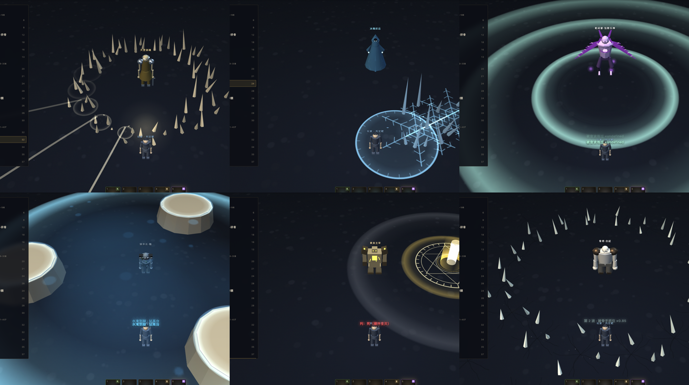

# Boss 技能组设计 · 从「换个颜色」到「换一套规则」

> 状态：**51 只全部进特效台**（`docs/boss-vfx-playground.html`），游戏侧未接入
> 45 只守卫各有**专属本命技**：一只一个函数，45 条机制、45 种动作（§7）
> 上一版的「8 个语法 + 45 行参数」已整体推翻 —— 那是换汤不换药
> 提出：2026-10-29 ｜ 更新：2026-10-31 ｜ 分支 `feat/skill-refactor`
> 前置：`docs/BOSS-VFX-PLAN.md`（表现层盘点）—— 那份解决「只有一个圈」，
> 这份解决「每只 Boss 打起来一样」。

---

## 0. 一句话

旧结构是 **13 种共享技撑 39 个技能位**，`slam` / `ringshot` / `charge` 各被 6 只共用、
`summon` 被 8 只共用 —— **换 Boss 只是换颜色**。

现在台上有 51 只，按「跟玩家较劲的方式」分成三档，**这一档比一只只调数值重要得多**：

| 档 | 数量 | 技能从哪来 | 状态 |
|---|---|---|---|
| **世界 Boss** | 6 | 1 领域 + 3 招，**四格全部独占**，一阶段一换套 | ✅ 已做完 |
| 八部 / 地宫 | 13 | 第 1 格机制独占 + **第 5 格本命技独占**，中间三格取自共享池 | ✅ 已有独占位 |
| 章节守卫 | 32 | 同八部：**第 5 格本命技独占**（§7），前四格仍是家族相似 | ✅ 已有独占位 |

---

## 1. 暗黑 2 的 Boss 到底靠什么制造挑战

不是伤害数字，是**限制玩家的行动**。拆开看只有五条：

| 原则 | 暗黑 2 的例子 | 玩家被迫做的事 |
|---|---|---|
| **场地被切割** | 暗黑（Diablo）的火墙、墨菲斯托的环形弹幕 | 只能从缺口走，站位变成决策 |
| **持续区域累积** | 安达利尔的毒新星、尼拉塞克的毒云 | 不能站桩，必须一直挪 |
| **限时目标** | 尼拉塞克的尸爆（先清尸体）、巴尔的分身 | 优先级判断：先打谁 |
| **定向威胁** | 都瑞尔的冲锋（直线、有前摇） | 侧闪/绕背，而不是后退 |
| **读条与打断** | 巴尔的冰冻波、女伯爵的火墙 | 打断 or 躲远，二选一 |

反面教材正是我们现在的状态：**全部是"以 Boss 为圆心的圆"** ——
玩家的唯一反应是"往外跑"，跑出去就安全，于是所有 Boss 同一种解法。

> 判据：如果一个技能的解法是"离开圆心"，那它和别的技能没有区别。
> 新机制必须各自对应**不同的动作**：绕背、离开扇面、拉开距离、走进圈内、
> 打掉目标、背对、抢时间、认核。

---

## 2. 45 只章节 / 八部 / 地宫首领

每只四格：**机制位（独占）｜ 套路位 ×2（取自真实 `patterns`）｜ 签名位**。
最后那列「这一战考什么」来自机制技的 `counter`，**它才是验收标准**，
不是技能名。

### 卷一 · 朽骨钥（Lv 1~18） · 6 只

| Boss | 机制位（第 1 格） | 套路位（第 2/3 格） | 签名位（第 4 格） | 这一战考什么 |
|---|---|---|---|---|
| 巨木妖王 | **孢子云** | 砸地 / 藤蔓 | 万竹穿心 | 三片云同时落下，只有中间那条缝能站 |
| 血蝠魔君 | **噬血链** | 环射 / 冲撞 | 血月俯冲 | 链子连着你每秒回血，拉开 7 码或绕到它背后才断 |
| 半兽人酋长·碎骨 | **战图腾** | 砸地 / 冲撞 | 裂地战吼 | 图腾给周围回血、5 秒后炸开，优先打掉它（判定圈就是爆炸范围） |
| 石甲巨魔 | **岩甲朝向** | 砸地 / 落石 | 岩枪天降 | 正面 120° 伤害 −80%，转身要 1.2 秒 —— 贴身绕到背后打 |
| 蛇姬·青鳞 | **石化凝视** | 毒新星 / 环射 | 毒牙缠咬 | 扇形视线扫过，被照到定身 2 秒 —— 绕到它身后或离开扇面 |
| 骨塔主持 | **孵化卵囊** | 诅咒 / 召唤 | 万魂缚 | 三个卵囊 6 秒后孵出小蛛，优先转火打掉（各有独立小圈） |

### 卷二 · 青铜钥（Lv 19~30） · 8 只

| Boss | 机制位（第 1 格） | 套路位（第 2/3 格） | 签名位（第 4 格） | 这一战考什么 |
|---|---|---|---|---|
| 幽魂道尊 | **魂锁拖拽** | 环射 / 诅咒 | 万魂缚 | 锁链把你往 Boss 拖，同时脚下落腐蚀圈 —— 反向跑 + 别站在圈里 |
| 赤炎魔将 | **火墙** | 砸地 / 火线 | 焚天斩 | 两道火墙横穿场地并停留 4 秒，只能从缺口绕 —— 别被夹在中间 |
| 冰魄妖后 | **冰封** | 冰新星 / 环射 | 千里冰封 | 被冻住要立刻连点（模拟），2.5 秒内挣脱；解慢了下一次就是处决 |
| 万毒蛛母 | **孵化卵囊** | 召唤 / 毒新星 | 蛛网天罗 | 三个卵囊 6 秒后孵出小蛛，优先转火打掉（各有独立小圈） |
| 熔脉之主·赤髓 | **落石** | 砸地 / 火线 | 岩枪天降 | 七个落点铺满场地，中间有缝 —— 别跑，走缝 |
| 灰烬守望者 | **火墙** | 地震 / 落石 | 焚天斩 | 两道火墙横穿场地并停留 4 秒，只能从缺口绕 —— 别被夹在中间 |
| 焚风怨灵 | **孢子云** | 环射 / 火线 | 焚天斩 | 三片云同时落下，只有中间那条缝能站 |
| 焚天炎帝 | **火墙** | 砸地 / 火线 | 焚天斩 | 两道火墙横穿场地并停留 4 秒，只能从缺口绕 —— 别被夹在中间 |

### 卷三 · 玄铁钥（Lv 31~40） · 7 只

| Boss | 机制位（第 1 格） | 套路位（第 2/3 格） | 签名位（第 4 格） | 这一战考什么 |
|---|---|---|---|---|
| 冥河渡者 | **摆渡** | 地震 / 环射 | 忘川潮 | 被传送到场地边缘，原位置留一个爆炸圈 —— 传送后立刻再走一步 |
| 天罡剑魂 | **剑域** | 剑雨 / 冲撞 | 万剑归宗 | 十二把剑围成剑域，圈内每 0.8 秒吃剑气 —— 要么出去，要么贴边躲剑锋 |
| 髓主 | **岩甲朝向** | 地震 / 砸地 | 岩枪天降 | 正面 120° 伤害 −80%，转身要 1.2 秒 —— 贴身绕到背后打 |
| 忘川怨魂 | **魂锁拖拽** | 环射 / 诅咒 | 忘川潮 | 锁链把你往 Boss 拖，同时脚下落腐蚀圈 —— 反向跑 + 别站在圈里 |
| 深渊古蟒 | **噬血链** | 冲撞 / 砸地 | 毒牙缠咬 | 链子连着你每秒回血，拉开 7 码或绕到它背后才断 |
| 黄泉主宰 | **摆渡** | 地震 / 环射 | 忘川潮 | 被传送到场地边缘，原位置留一个爆炸圈 —— 传送后立刻再走一步 |
| 混沌·无相天魔 | **无相分身** | 砸地 / 环射 | 无相劫 | 三个分身放同样的小弹幕，真身胸口有核 —— 打分身只会浪费时间 |

### 卷四 · 赤金钥（Lv 41~50） · 5 只

| Boss | 机制位（第 1 格） | 套路位（第 2/3 格） | 签名位（第 4 格） | 这一战考什么 |
|---|---|---|---|---|
| 剑冢守灵 | **剑域** | 剑雨 / 冲撞 | 万剑归宗 | 十二把剑围成剑域，圈内每 0.8 秒吃剑气 —— 要么出去，要么贴边躲剑锋 |
| 万剑之君 | **无相分身** | 剑雨 / 环射 | 万剑归宗 | 三个分身放同样的小弹幕，真身胸口有核 —— 打分身只会浪费时间 |
| 剑帝 | **剑域** | 剑雨 / 冲撞 | 万剑归宗 | 十二把剑围成剑域，圈内每 0.8 秒吃剑气 —— 要么出去，要么贴边躲剑锋 |
| 云海守将 | **风压** | 砸地 / 冲撞 | 裂地战吼 | 风一直把人往外推，越站越远 —— 逆着风走位，别只顾躲招 |
| 南天守门神 | **岩甲朝向** | 地震 / 砸地 | 岩枪天降 | 正面 120° 伤害 −80%，转身要 1.2 秒 —— 贴身绕到背后打 |

### 卷五 · 九霄钥（Lv 51~60） · 6 只

| Boss | 机制位（第 1 格） | 套路位（第 2/3 格） | 签名位（第 4 格） | 这一战考什么 |
|---|---|---|---|---|
| 玉京残帝 | **战图腾** | 砸地 / 环射 | 万剑归宗 | 图腾给周围回血、5 秒后炸开，优先打掉它（判定圈就是爆炸范围） |
| 陨星之主 | **落石** | 陨石 / 环射 | 岩枪天降 | 七个落点铺满场地，中间有缝 —— 别跑，走缝 |
| 无相天魔 | **无相分身** | 砸地 / 环射 | 无相劫 | 三个分身放同样的小弹幕，真身胸口有核 —— 打分身只会浪费时间 |
| 镜渊之主 | **无相分身** | 环射 / 冲撞 | 无相劫 | 三个分身放同样的小弹幕，真身胸口有核 —— 打分身只会浪费时间 |
| 九霄神将 | **剑域** | 砸地 / 冲撞 | 万剑归宗 | 十二把剑围成剑域，圈内每 0.8 秒吃剑气 —— 要么出去，要么贴边躲剑锋 |
| 混沌·无相天魔（真身） | **无相分身** | 砸地 / 环射 | 无相劫 | 三个分身放同样的小弹幕，真身胸口有核 —— 打分身只会浪费时间 |

### 八部天龙（破防 + 元素弱点） · 8 只

| Boss | 机制位（第 1 格） | 套路位（第 2/3 格） | 签名位（第 4 格） | 这一战考什么 |
|---|---|---|---|---|
| 帝释·持杵天主 | **破防窗口** | 砸地 / 环射 | 裂地战吼 | 它的招牌招有后摇，收招后 2.5~4 秒是破绽（伤害 ×1.5）；属性上有一个 −60 的洞，换对元素再打 ×1.6 |
| 难陀·盘渊龙众 | **破防窗口** | 砸地 / 环射 | 毒牙缠咬 | 它的招牌招有后摇，收招后 2.5~4 秒是破绽（伤害 ×1.5）；属性上有一个 −60 的洞，换对元素再打 ×1.6 |
| 毗沙·四臂鬼将 | **破防窗口** | 砸地 / 地震 | 岩枪天降 | 它的招牌招有后摇，收招后 2.5~4 秒是破绽（伤害 ×1.5）；属性上有一个 −60 的洞，换对元素再打 ×1.6 |
| 乾闼婆·弦歌乐神 | **破防窗口** | 环射 / 诅咒 | 万魂缚 | 它的招牌招有后摇，收招后 2.5~4 秒是破绽（伤害 ×1.5）；属性上有一个 −60 的洞，换对元素再打 ×1.6 |
| 罗睺·三头阿修罗 | **破防窗口** | 砸地 / 冲撞 | 焚天斩 | 它的招牌招有后摇，收招后 2.5~4 秒是破绽（伤害 ×1.5）；属性上有一个 −60 的洞，换对元素再打 ×1.6 |
| 金翅·迦楼罗王 | **破防窗口** | 冲撞 / 环射 | 血月俯冲 | 它的招牌招有后摇，收招后 2.5~4 秒是破绽（伤害 ×1.5）；属性上有一个 −60 的洞，换对元素再打 ×1.6 |
| 紧那罗·鹿鸣乐天 | **破防窗口** | 环射 / 藤蔓 | 万魂缚 | 它的招牌招有后摇，收招后 2.5~4 秒是破绽（伤害 ×1.5）；属性上有一个 −60 的洞，换对元素再打 ×1.6 |
| 摩睺罗迦·大蟒腹 | **破防窗口** | 砸地 / 藤蔓 | 毒牙缠咬 | 它的招牌招有后摇，收招后 2.5~4 秒是破绽（伤害 ×1.5）；属性上有一个 −60 的洞，换对元素再打 ×1.6 |

### 地宫首领（场地机制） · 5 只

| Boss | 机制位（第 1 格） | 套路位（第 2/3 格） | 签名位（第 4 格） | 这一战考什么 |
|---|---|---|---|---|
| 骨将·白起 | **尸潮** | 砸地 / 地震 | 万魂缚 | 六个裂口同时开，爬出来的东西会一直变多 —— 拖不是策略 |
| 矿主·塌 | **落石** | 地震 / 砸地 | 岩枪天降 | 七个落点铺满场地，中间有缝 —— 别跑，走缝 |
| 獠王 | **兽鼓** | 冲撞 / 砸地 | 裂地战吼 | 场边那面鼓会一直叫兽群来 —— 先砸鼓（判定圈在鼓上，不在 Boss 上） |
| 狱卒长·枷 | **水位** | 环射 / 诅咒 | 万魂缚 | 水每 20 秒涨一圈，安全区一直在缩 —— 泡在水里持续掉血，逼你往前打 |
| 堕天者 | **风压** | 砸地 / 环射 | 无相劫 | 风一直把人往外推，越站越远 —— 逆着风走位，别只顾躲招 |

> 看完这张表就能看出问题：`石甲巨魔` / `髓主` 都是「岩甲朝向」，
> `赤炎魔将` / `焚天炎帝` / `灰烬守望者` 都是「火墙 + 焚天斩」。
> 机制位只有 18 种、签名位只有 12 种，45 只摊下来必然重复 —— §7 是这件事的账。

---

## 2-B. 6 只世界 Boss（四格全独占）

数据照 `origin/feat/act-expansion` 的 `src/data/data-worldboss.js`，
模型照 `src/wbmodels.js` 移植（**真实米数建模**，进台时按 `wbScale` 缩小）。
共同设计语言：

- **没有 `patterns`** —— 那是八部天龙的语言（共用池）。世界 Boss 每只三招独占。
- **没有元素缺口** —— 抗性五项同值。八部考「换武器」，这里考「换站位 / 读阶段」。
- **领域是唯一识别符号** —— 进场就有一条持续规则在改玩家，不是一段技能动画。
- **三阶段按血量比例** 1.00 / 0.66 / 0.33，每段换一套招 + 改一条规则。

### 烛九阴 · 钟山之神 · 视为昼瞑为夜

**领域 · 昼夜领域** ｜ 常驻规则：夜：视野 8 米 ｜ 视野 26 → 8 米

| 阶段 | 名称 | 变化 | 进入时 |
|---|---|---|---|
| P1 | 睁眼 · 昼 | 视野正常，直线龙息 + 尾扫 | `sight 26` |
| P2 | 闭眼 · 夜 | 视野压到 8 米，暗潮解禁 | `sight 8` |
| P3 | 昼夜交替 | 每 6 秒切一次，两套技能同时出 | `dayNight 6s` |

| 技能 | 形态 | 前摇 | 倍率 | 解法（**每一只都不同**） |
|---|---|---|---|---|
| **龙息** | 长条穿透 | 1.1s | ×2.2 | 横向让开条带 —— 往后跑仍然是同一条线 |
| **尾扫** | 近身惩罚 | 0.7s | ×1.6 | 扇面 160° —— 站在背后那 200° 里 |
| **暗潮** | 夜限 · 全向 | 1.6s | ×2.8 | 半径 22 米，而夜里的视野只有 8 米：先记住它在哪，再往外跑 |

### 相柳 · 共工之臣 · 九首食于九山

**领域 · 毒沼领域** ｜ 常驻规则：地面持续掉血 ｜ 地面持续掉血

| 阶段 | 名称 | 变化 | 进入时 |
|---|---|---|---|
| P1 | 三头主攻 | 三头出手，六头观望 | `heads 3` |
| P2 | 六头齐出 | 六头各带一色，正面站不住 | `heads 6` |
| P3 | 九头全开 | 九头同时出手，场地化毒沼 | `heads 9` |

| 技能 | 形态 | 前摇 | 倍率 | 解法（**每一只都不同**） |
|---|---|---|---|---|
| **毒喷** | 三头轮喷 | 0.6s | ×1.8 | 三发不同角度错开 0.35s：别停在原地等它喷完 |
| **九首齐啸** | 全领域 · 长前摇 | 3s | ×3.2 | 28 米全覆盖，3 秒前摇：这是唯一必须跑出去的一招 |
| **毒尾鞭** | 死角在背后 | 0.5s | ×1.4 | 扫过 200°，背后 160° 是死角 —— 绕到正后方 |

### 鲲鹏 · 北冥之鱼 · 化而为鸟

**领域 · 水天领域** ｜ 常驻规则：涉水者移速 −20% ｜ 移速 −20%

| 阶段 | 名称 | 变化 | 进入时 |
|---|---|---|---|
| P1 | 鲲 | 贴水，笨重，但一拳很重 | `morph kun` |
| P2 | 化鹏 | 飞空后近战够不到，只能远程与跳斩 | `morph peng` |
| P3 | 鲲鹏同体 | 半空半水，两套技能轮换 | `morph both` |

| 技能 | 形态 | 前摇 | 倍率 | 解法（**每一只都不同**） |
|---|---|---|---|---|
| **水炮** | 穿透 | 0.9s | ×2 | 水柱只走正面一条：侧移两步即可，硬吃没有减伤 |
| **风刃** | 双段 | 0.6s | ×2.4 | 两段风刃间隔 0.3 秒：躲完第一段立刻再让一次 |
| **潜渊** | 落点 | 1.4s | ×1.8 | 落点在你的位置，预警 1.4 秒：走开就行，但水里走得慢 |

### 饕餮 · 钩吾之山 · 食人无厌

**领域 · 吞噬领域** ｜ 常驻规则：持续被拉向它 ｜ 持续被拉向它

| 阶段 | 名称 | 变化 | 进入时 |
|---|---|---|---|
| P1 | 吞噬 | 吸气把玩家往嘴里拉，锥形巨口 | `pull ×1` |
| P2 | 反刍 | 把吞下的东西吐回来当投射物 | `regurgitate` |
| P3 | 饥狂 | 全场吸力 ×1.5，攻速 +50% | `pull ×1.5` |

| 技能 | 形态 | 前摇 | 倍率 | 解法（**每一只都不同**） |
|---|---|---|---|---|
| **吞咽** | 强制位移 | 1.5s | ×3 | 被吸住时**反向跑**：顺着力气走会被拽进嘴里再吃一发 |
| **反刍** | 散射 | 0.9s | ×2.6 | 12 颗落点散开：找空隙，不是找圆心 |
| **震地** | 近身惩罚 | 0.7s | ×1.8 | 贴身才吃得到：它抬身时往外退两步 |

### 刑天 · 常羊之山 · 以乳为目以脐为口

**领域 · 战意领域** ｜ 常驻规则：玩家攻速 −15% ｜ 攻速 −15%

| 阶段 | 名称 | 变化 | 进入时 |
|---|---|---|---|
| P1 | 斧 | 大开大合，慢而痛，抬手 1.2 秒 | `stance axe` |
| P2 | 盾 | 格挡正面，必须绕后 | `blockFront` |
| P3 | 舞干戚 | 攻速 ×2、伤害 +30%，但不再格挡 | `stance both` |

| 技能 | 形态 | 前摇 | 倍率 | 解法（**每一只都不同**） |
|---|---|---|---|---|
| **斧劈** | 长抬手 | 1.2s | ×2.8 | 1.2 秒抬手，斧落只有正面 100°：让到侧后 |
| **盾撞** | 推进 | 0.9s | ×2.2 | 直线推进 14 米：往侧面走，别顺着直线退 |
| **战吼** | 自身增益 | 0.8s | ×0 | 不造成伤害，但接下来 8 秒它更快：这段时间用来拉开距离 |

### 九尾狐 · 青丘之山 · 九尾能食人

**领域 · 幻域** ｜ 常驻规则：小地图变暗 ｜ 小地图变暗

| 阶段 | 名称 | 变化 | 进入时 |
|---|---|---|---|
| P1 | 幻影 | 三个分身，一真二假，假的一击碎 | `clones 2` |
| P2 | 九尾缚 | 尾巴横扫 + 缠绕定身 | `tails 9` |
| P3 | 狐火焚天 | 全场狐火，真身现身时受伤 ×2 | `revealVuln` |

| 技能 | 形态 | 前摇 | 倍率 | 解法（**每一只都不同**） |
|---|---|---|---|---|
| **狐火** | 留余烬 | 1s | ×2.4 | 火灭了地还在烧：3 秒内别走回原来的位置 |
| **尾缚** | 定身 · 内圈安全 | 1.3s | ×1.6 | 环形判定，中心是空的：贴身站进去（与"尾扫"相反） |
| **幻影突袭** | 只有一条是真的 | 0.5s | ×2 | 三条突进里只有本尊有判定：认胸口那颗核 |

**六只的解法互不重复**（这是这一档的验收线）：

| Boss | 一句话解法 | 别的 Boss 不能这么说 |
|---|---|---|
| 烛九阴 | 背昼夜时间轴，趁睁眼那几秒把输出打完 | 唯一改**视野**的 |
| 相柳 | 数头判断阶段，然后对冲那一下 | 唯一把**血量阶段外化成 9 个头**的 |
| 鲲鹏 | 贴水还是拉远，阶段一变整个反过来 | 唯一**换骨架**的（鱼 ↔ 鸟） |
| 饕餮 | 被吸时反向跑，别顺着力气走 | 唯一**主动改玩家站位**的 |
| 刑天 | 绕背（正面被盾格挡），P3 只能拉开 | 唯一**站位决定能不能打出伤害**的 |
| 九尾狐 | 认胸口那颗核，不认位置 | 唯一**信息本身就是谜题**的 |

---

## 3. 共用的是"原语"，不是"技能"

上一版的问题是把**技能**共享了；正确做法是共享**原语**：

| 原语 | 用途 | 谁在用 |
|---|---|---|
| `BFX.zone({shape})` | circle / ring / rect(线) / sector(扇形) / scatter(多点) 五种预警 | 全部（形状跟着判定走） |
| `BFX.column` | 竖柱（火柱/水柱/光柱） | 龙息、水炮、狐火、火墙 |
| `BFX.spikes` | 地刺/藤蔓/冰棱/尾刺 | 藤蔓、千里冰封、尾缚、卵囊 |
| `BFX.boulder` | 落石（可带火拖尾） | 落石、陨石、反刍的腐骨 |
| `BFX.blade` | 剑影（剑尖朝下） | 剑雨、剑域、万剑归宗 |
| `BFX.wave` | 立起来的冲击墙 | 砸地、震地、九首齐啸、暗潮、战吼 |
| `BFX.arcSlash` | 立起来的弧刃（横斩） | 尾扫、风刃、斧劈、幻影突袭 |
| `BFX.ribbon` | 有宽度的丝/链 | 噬血链、魂锁、石化视线 |
| `BFX.decal` | 焦痕/裂纹/霜纹/毒斑/蛛网/法阵 | 全部 |
| `WBDOM` | 领域：常驻边界 + 每种一条自己的"活物" | 6 只世界 Boss |
| `NR`（45 个） | 45 只守卫的本命技，**一只一个函数**，没有语法表（§7） | 45 只守卫的第 5 格 |

> 这里曾经有一行 `NSYN（8 个）`，写的是"共用动作语法：喷/扫/砸/追/围/标记/回响/改地"。
> 那 8 个函数就是 8 个模板 —— 45 只分下去，每只分到的差异只有颜色和名字。
> **已删。** 共享到"语法"这一层就已经太多了：语法一样，打出来的东西就一样。

**判定与预警必须同源**：`skill.hit()` 返回的数字，既用来画预警，也用来判命中。
特效台里"显示判定形状"就是把这份数字画成红线——对不上就是 bug。

---

## 4. 还需要游戏侧支持的五件事

特效台只是"看得见"，要真的成立还得改 `src/game.js`：

1. **状态位**：定身（石化/冰封/尾缚）、拉拽（魂锁/吞咽）、位移（摆渡/冲撞/潜渊）——
   现在玩家只有减速，没有"不可控位移"和"定身"。
2. **可破坏目标**：图腾、卵囊需要有血量与仇恨（现在 `enemies` 里只有怪）。
3. **减伤朝向**：`stonearmor` / 刑天的盾需要"从正面来的伤害 ×0.2"的判定，
   即伤害来源与 Boss 朝向的点积。
4. **限时/读条**：卵囊 6 秒、图腾 5 秒、九首齐啸 3 秒，需要挂在 Boss 状态机上的
   定时器，而不是 `setTimeout`（切图会漏）。
5. **领域**：一条**每帧都生效**的规则（视野 / 移速 / 持续掉血 / 吸力 / 攻速 /
   小地图）。它不进伤害管线，走的是 `updatePlayer` 里的乘区。

---

## 5. 落地顺序

| 批 | 内容 | 为什么这个顺序 |
|---|---|---|
| **A** | `zone` 五形状 + 判定同源 | 一个改动同时修掉「全是圆」和「形状≠判定」 |
| **B** | 18 个专属机制（§2 第 1 格） | 这是"换 Boss 有新鲜感"的全部来源 |
| **C** | 状态位（定身/拉拽/位移） | B 里有 5 个机制依赖它 |
| **D** | 6 只世界 Boss（领域 + 三阶段 + 18 招） | 依赖 C 的位移与状态位，也必须最后做 |
| **E** | 45 只的**本命技**（§7），每只独占第 5 格 | ✅ 已做完 —— 51 只没有两只同套 |

> 顺序不能倒：先做表现升级会得到一堆好看但仍然同质的技能。

---

## 6. 验收

- **一句话测试**：任取一个机制技，遮住血条后玩家能不能说出"我该做什么"。
- **同质化测试**：两两比较，**解法动词**不得重复
  （绕背 / 离开扇面 / 拉距离 / 打目标 / 抢时间 / 反向跑 / 认核 / 走出去）。
- **判定一致**：开「显示判定形状」，红线必须与预警的边界重合。
- **技能组不重复**：51 只里**不许出现两只技能组完全相同**。现在是 5 格
  （世界 Boss 4 格），**0 对重复**；前四格还剩 7 对重复，全被第 5 格拆开了。

---

## 7. 45 只的本命技：一只一个函数，没有语法表

### 7.1 上一版错在哪

上一版这里是一张 **8 行语法表**（喷 / 扫 / 砸 / 追 / 围 / 标记 / 回响 / 改地）
配 45 行参数，靠「排布 × 时序」把两只分开。查重脚本跑出来 45 个三元组互不相同，
看起来很干净 —— 但玩家看到的不是三元组：

> **9 只「砸」打出来全是"天上掉东西 → 红圈 → 爆"。**
> 名字不一样、颜色不一样，做的动作一样。

参数化到那个粒度，剩下的差异就只有颜色和名字。这就是"换汤不换药"的来源，
而且我上一版还写过一句"共用动作语法，不共用动作"给自己找台阶 —— 那是自欺。

### 7.2 这一版怎么做

**没有语法表。** 每只一个函数（`NR.<id>`），自己写完自己的前摇、判定、表现。
共享的只有**原语**（`zone` / `spikes` / `ribbon` / `decal` / `shock`），不是技能。

判据只有一条，写在每只的 `rule` 里：

> **这一招逼玩家做的动作，和别的 44 只都不一样。**

形状不是判据 —— 静态形状只有 6 种（圆 / 环 / 扇 / 线 / 散 / 自身），
45 只不可能靠形状区分。区别在**什么时候、站在哪、动还是不动**。

45 种动作大致落在这些轴上：一直跑 / 站着别动 / 侧移 / 转身 / 主动走进去 /
冲出去 / 往中间收 / 往外跑 / 贴上去 / 拉开 / 记顺序 / 读轨迹 / 认目标 /
认清"哪个是我" / 抢时间拆目标 / 控自己输出的节奏。

几个例子（都是别处没有的）：

| Boss | 为什么它不一样 |
|---|---|
| 巨木妖王 **绞根** | 唯一一个"**停下就输**"的 —— 别的招教你躲开某处，这个不许你保持静止 |
| 冰魄妖后 **霜华** | 唯一一个"**直线跑必中**"的 —— 它打你 0.9 秒前站的格子，跑得越直越撞自己的脚印 |
| 黄泉主宰 **判词** | 唯一一个**反向**的 —— 全场都在教你躲，这一招要你**主动走进去** |
| 迦楼罗 **金翅** | 唯一一个**距离反直觉**的 —— 风刃在远处交汇，**贴到它脚下才活** |
| 混沌真身 **因果** | 唯一一个**预判**的 —— 落点压在你正在去的方向上，直线跑必中，得变向 |
| 无相天魔 **镜我** | 唯一一个**用玩家外形**的 —— 场上多一个"你"，先分清哪个是自己 |

### 7.3 45 行表（从代码导出，不是手抄）

> 表本体是 `docs/boss-vfx-playground.html` 里的 `NR`；这一节由它生成。
> 改代码 → 重新导出，文档和实现不会走散。

#### 卷一 · 朽骨钥（Lv 6~18）
| Boss | Lv | 本命技 | 逼玩家做的事 | 判定 | 前摇 |
|---|---|---|---|---|---|
| 巨木妖王 | 6 | **绞根** | 藤蔓在你脚下不断长出来 —— 停住 0.7 秒就被缠死 | 圆 R2.3 | 0.90s |
| 血蝠魔君 | 8 | **掠空** | 笔直俯冲，落地有硬直 —— 让开一步，然后全力打 | 直线 3.2×14.6 | 0.90s |
| 半兽人酋长·碎骨 | 12 | **裂地冲锋** | 先被震退，再让出冲线，最后躲四散的碎石 —— 三次躲避各不相同 | 环 R7.5 / 1.2 | 1.00s |
| 石甲巨魔 | 18 | **剥甲** | 每挨一下掉一块甲，石块落在场上 3 秒后炸 —— 打得凶，场地就没了 | 圆 R4.0 | 1.00s |
| 蛇姬·青鳞 | 16 | **蜕皮** | 蛇皮留在原地继续喷毒，本体在你背后出现 —— 别背对它 | 圆 R3.6 | 1.50s |
| 骨塔主持 | 13 | **诵经** | 三面经幡同时念，四秒后整块地变骷髅地 —— 必须先去拆 | 经幡未拆 → 全场 | 3.50s |

#### 卷二 · 焚天炉（Lv 19~30）
| Boss | Lv | 本命技 | 逼玩家做的事 | 判定 | 前摇 |
|---|---|---|---|---|---|
| 幽魂道尊 | 20 | **附影** | 钻进你的影子，从背后冒出来 —— 正面是安全的，转身才看见 | 圆 R2.2 | 0.90s |
| 赤炎魔将 | 21 | **三叠火墙** | 三道火墙从远到近依次推来，每道缺口都在不同的位置 —— 走 Z 字穿过去 | 三道墙依次推进 | 1.00s |
| 冰魄妖后 | 24 | **霜华** | 冰锥落在你 0.9 秒前的脚下 —— 直线跑必中，得拐弯 | 圆 R2.6 | 0.90s |
| 万毒蛛母 | 28 | **织网** | 六条蛛丝从中心射出去 —— 缝里安全，但一移动就会踩到丝 | 散 ×6  R1.6 | 1.00s |
| 熔脉之主·赤髓 | 24 | **裂脉** | 地裂开一条缝，每秒往两端延长 —— 站在延长方向上会被追上 | 直线 2.4×22.0 | 1.20s |
| 灰烬守望者 | 26 | **灰暴** | 全场起灰，视野只剩 12 米，风一直把你往一侧推 —— 得逆着风走 | 视野压制 + 持续推力 | 1.00s |
| 焚风怨灵 | 28 | **附身** | 它钻进附近一只小怪里，那只变红变大 —— 打别的都没用 | 圆 R3.2 | 2.20s |
| 焚天炎帝 | 30 | **天火轮** | 两圈天火反向旋转，第二圈错开半格 —— 跟着转才卡得住缝 | 两圈反向旋转的天火 | 1.00s |

#### 卷三 · 剑冢（Lv 31~40）
| Boss | Lv | 本命技 | 逼玩家做的事 | 判定 | 前摇 |
|---|---|---|---|---|---|
| 冥河渡者 | 32 | **引渡** | 一条引魂索连着你，持续把你往它那边拽 —— 得一直往外走 | 圆 R4.5 | 1.00s |
| 天罡剑魂 | 32 | **万剑** | 十六柄剑从场地边缘向内同时射来 —— 往外跑正好撞上，要往缝里钻 | 十六柄剑由外向内 | 1.00s |
| 髓主 | 34 | **抽髓** | 一条骨线连着你，中间有石柱挡着才断 —— 正面躲是没用的 | 骨线：需要掩体 | 1.00s |
| 忘川怨魂 | 35 | **遗忘** | 被它摸到，随机一个技能灰掉 4 秒 —— 别让它贴身 | 圆 R3.4 | 0.90s |
| 深渊古蟒 | 37 | **盘踞** | 蟒身沿场边盘一圈，圈持续收缩 —— 可站的地方越来越小 | 环 R20.0 / 9.5 | 1.00s |
| 黄泉主宰 | 40 | **判词** | 地上写一道判词，站在圈里的是活人 —— 所有招都教你躲，这一招教你走进去 | 圆 R2.9 | 3.20s |
| 混沌·无相天魔 | 38 | **无相** | 每 3 秒换形态（环 / 扇 / 散）—— 认错了就躲错方向 | 形态决定形状 | 1.10s |

#### 卷四 · 九霄（Lv 42~50）
| Boss | Lv | 本命技 | 逼玩家做的事 | 判定 | 前摇 |
|---|---|---|---|---|---|
| 剑冢守灵 | 42 | **剑围** | 一圈剑插在四周，只有一处缺口，而且缺口每 0.9 秒换一个位置 | 环 R15.0 / 9.0 | 1.00s |
| 万剑之君 | 44 | **剑气潮** | 一整面剑气墙从一侧推到另一侧，一个缺口都没有 —— 只能比它快 | 整面墙推进 | 1.00s |
| 剑帝 | 45 | **一剑** | 蓄力三秒，地上只有一条头发丝粗的红线 —— 找不到它就躲不掉 | 直线 1.0×30.0 | 3.00s |
| 云海守将 | 49 | **断桥** | 脚下的云一块块塌掉，塌过的地方永远不能站 —— 可站面积只会变小 | 散 ×6  R3.0 | 1.00s |
| 南天守门神 | 50 | **天门转** | 一道扇面光柱绕场旋转，扫到就烧 —— 得一直跟着它背面走 | 扇 18.0 · 112° | 1.00s |

#### 卷五 · 终焉（Lv 51~60）
| Boss | Lv | 本命技 | 逼玩家做的事 | 判定 | 前摇 |
|---|---|---|---|---|---|
| 玉京残帝 | 52 | **玉玺** | 玉玺砸下后留在场上成为石柱 —— 躲开它，然后拿它当掩体 | 散 ×3  R3.4 | 1.30s |
| 陨星之主 | 54 | **陨星** | 陨星拖着一条可见的轨迹划过天空，轨迹的终点才是落点 | 散 ×4  R2.6 | 1.00s |
| 无相天魔 | 56 | **镜我** | 复制出一个"你"（暗色），它会替你出招 —— 先认清楚哪个才是自己 | 分身替它出手 | 1.00s |
| 镜渊之主 | 57 | **镜面** | 场地整整半边变成镜面，站在上面会被自己的伤害反噬 —— 换半边 | 扇 26.0 · 180° | 1.00s |
| 九霄神将 | 58 | **雷链** | 几道雷落在场上，相邻两道之间会拉出一道电链 —— 站在链上也死 | 散 ×6  R2.0 | 1.00s |
| 混沌·无相天魔（真身） | 60 | **因果** | 它算准你正在往哪跑，落点压在你前面 —— 直线跑必中，必须变向 | 圆 R3.0 | 1.00s |

#### 八部天龙（Lv 60）
| Boss | Lv | 本命技 | 逼玩家做的事 | 判定 | 前摇 |
|---|---|---|---|---|---|
| 帝释·持杵天主 | 60 | **杵落** | 雷杵砸下来是一个十字 —— 只有四个斜角是空的 | 十字：两条交叉的线 | 1.00s |
| 难陀·盘渊龙众 | 60 | **龙息** | 一道水柱持续喷射，慢慢转向你 —— 绕圈跑，别让它把角度咬住 | 扇 20.0 · 40° | 1.00s |
| 毗沙·四臂鬼将 | 60 | **四臂** | 四条手臂顺时针依次横扫 90° 扇面 —— 跟着顺序走进刚扫过的那一格 | 四臂顺时针依次 | 1.00s |
| 乾闼婆·弦歌乐神 | 60 | **弦歌** | 三层音波由内向外一圈圈扩散 —— 卡在波与波之间，而不是站在某一圈 | 环 R24.0 / 14.0 | 1.00s |
| 罗睺·三头阿修罗 | 60 | **三头** | 三个头同时朝三个方向喷火，中间只留三条约 35° 的窄缝 | 三向同时 120° 间隔 | 1.00s |
| 金翅·迦楼罗王 | 60 | **金翅** | 两片风刃从左右扫出，在远处交汇 —— 拉开距离正好撞上，贴到它脚下才活 | 环 R26.0 / 4.5 | 1.00s |
| 紧那罗·鹿鸣乐天 | 60 | **鹿鸣** | 鹿群排成方阵从一侧推进，列与列之间有缝 —— 找那条列缝钻进去 | 方阵推进 | 1.00s |
| 摩睺罗迦·大蟒腹 | 60 | **消化** | 吐出的酸池每秒扩大一圈 —— 现在安全的地方，三秒后就不安全 | 散 ×1  R2.0 | 1.00s |

#### 地宫首领（Lv 36）
| Boss | Lv | 本命技 | 逼玩家做的事 | 判定 | 前摇 |
|---|---|---|---|---|---|
| 骨将·白起 | 36 | **尸潮** | 骨手从场地边缘一波波往里爬，一波比一波深 —— 得往中间退 | 边缘波次推进 | 1.00s |
| 矿主·塌 | 36 | **塌方** | 头顶落石只在地上投一个影子，影子越大越近 —— 没有红圈可躲 | 散 ×5  R2.4 | 1.20s |
| 獠王 | 36 | **兽群** | 狼群围成一整圈同时冲进来，只有一个方向是空的 —— 冲出去，不是往里躲 | 环 R26.0 / 6.0 | 1.00s |
| 狱卒长·枷 | 36 | **水位** | 水从地面升起，一直往上涨 —— 只有高台还在水面以上 | 水位持续上涨 | 1.00s |
| 堕天者 | 36 | **风压** | 一道龙卷绕着场地转圈，速度会变 —— 躲的是它下一秒的位置 | 圆 R3.6 | 1.00s |

### 7.4 怎么验的

- `NR` 45 键 ↔ 45 只非世界 Boss，**一一对应，0 缺失**；每只 `KIT` 末位就是 `nt_<它自己的 id>`。
- 45 条 `rule` 文案**互不相同**、45 个技能名**互不相同**。
- **51 只技能组两两不同**（世界 Boss 4 格、守卫 5 格，0 对重复）。
- 全量施放：**51 只 × 全部技能 = 249 次，0 报错**，页面 0 异常。
- 判定形状分布：圆 11 / 环 6 / 散 7 / 扇 3 / 线 3 / 整场 15。
  那 15 个「整场」不是增益 —— 它们各自按帧结算（视野压制、被拽、半场镜面、
  方阵推进……），面板上显示的是各自的 `note`，不是"无判定"。

六张图能一起看的原因：**它们逼玩家做的动作是六件不同的事**，不是六种颜色。
左上起：万剑（由外向内 → 往缝里钻）· 霜华（打 0.9 秒前的脚印 → 拐弯）·
弦歌（三圈音波扩出去 → 卡在两道波之间）· 水位（涨上来 → 往高处站）·
判词（反向 → 主动走进去）· 尸潮（边缘一波比一波深 → 往中间收）。

### 7.5 特效：每个原语在暗场景里到底长什么样

这一版最大的工作量不在机制，在**把机制画出来**。踩到的坑都能归到一句话：
**"我以为它长那样"**。

| 坑 | 真相 | 修法 |
|---|---|---|
| `column` 当火柱用 | 加法混合下任何颜色都变成一根**纯白光剑** | 火用尖刺（有锥度）+ 粒子；光柱只留给真的要发光的东西 |
| 竖着的剑 / 柱子 | 45° 俯视下**只投成一个点** | 换 `spikes`：锥体有斜面，从上往下能看到三角形 |
| `scorch` 焦痕 | NormalBlending，在近黑地面上是**一个洞**，不是"烧焦" | 传 `blend:'add'`，让它读作余烬 |
| 16 个 `zone` 同时开场 | 16 块发暗的圆盘 → 场地变成一块黑板 | 落点改 `shock`（ring 贴图，只有边亮） |
| 预警半径 / 落点距离 | 摆到 14~34 米 —— **整招在画面外**，等于没画 | 一律压进 12 米内（画面半径） |
| 一条 207° 的弧 | 加了 72° "余量" → 画成 279°，玩家以为背后也危险 | `k=1` 时余量为 0。**假安全区比不画更坏** |
| 密排的落点 | 固定间距 3.6 米配半径 2.4 → 互相压住，铺满整屏 | 间距 = `max(step, 半径 × 2.15)` |
| 「背后」的落点 | `aimAngle()` 是 Boss→玩家，**减号是正面**，加号才是背后 | 两处都写反了；而且正后方必然出框，偏到侧后方 |
| 假玩家站着不动 | "0.9 秒前的位置"就等于"现在"，机制演不出来 | 先在地上铺一串**脚印**，再从最远那格往回追 |
| 石头台座用 `column` | 同一个加法混合问题：0x8a7550 的"石头"打出来是一根**纯白发光管** | 石头走不透明的 `MeshStandardMaterial` 圆柱，只给台顶留一圈微光 |
| 结算瞬间开一根 9 米光柱 | 柱体比整个画面还大，把"圈里是活的"这个**唯一的答案**直接盖掉 | 结算用地面符文 + `shock`，中心只留 r0.85 的小信标 |
| 尸潮第一波摆在 17 米 | 固定镜头只看到约 12 米 —— **第一波等于没画**，机制少了一拍 | 收到 11 / 7.5 / 4，中心那一小块才是安全区 |

### 7.6 还剩什么

- **游戏侧一件都没接**：§4 那五件事（状态位 / 可破坏目标 / 减伤朝向 / 挂在状态机
  上的定时器 / 领域乘区）现在都还只在特效台里演。
- `src/fx2.js` 没建：`BFX` / `NR` / `WBDOM` 全挤在 `docs/boss-vfx-playground.html` 里。
- **移动中的判定表达不了**：只有六种静态形状。"扫到一半停下""墙慢慢推过来"
  只能把整段会挨到的范围一次画出来。这条要等 `zone` 支持带时间的扫掠形状。
- 少数几只的视觉还不够读：踏天者的龙卷、阿修罗的"三个头"（现在读作三簇火星）。
  机制是对的，表现还要再调。
