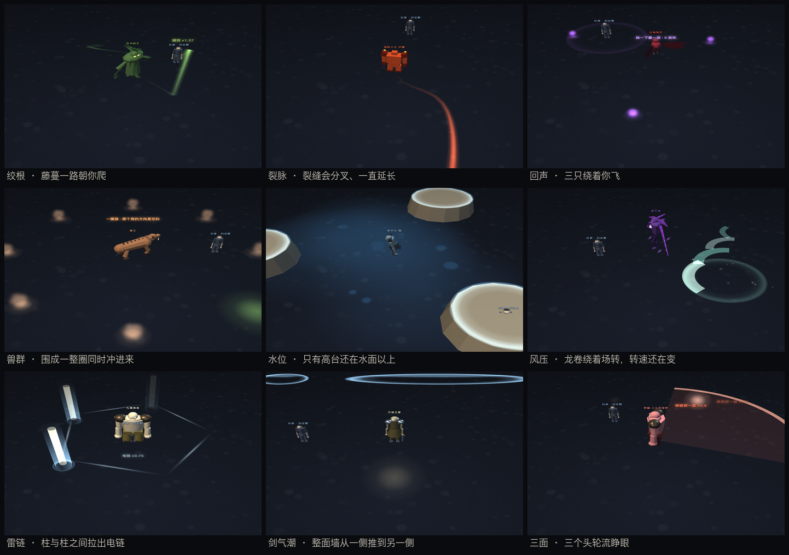

# Boss 技能组设计 · 从「换个颜色」到「换一套规则」

> 状态：**51 只全部进特效台**（`docs/boss-vfx-playground.html`），游戏侧未接入  
> 45 只守卫各有**专属本命技**：一只一个函数，45 条机制、45 种动作（§7）  
> 演出层已从「一次性特效」换成「**活物原语**」（§7.7）：东西留在场上、自己会动  
> 提出：2026-10-29 ｜ 更新：2026-11-01 ｜ 分支 `feat/skill-refactor`  
> 前置：`docs/BOSS-VFX-PLAN.md`（表现层盘点）—— 那份解决「只有一个圈」，  
> 这份解决「每只 Boss 打起来一样」。

---

## 0. 一句话

旧结构是 **13 种共享技撑 39 个技能位**，`slam` / `ringshot` / `charge` 各被 6 只共用、  
`summon` 被 8 只共用 —— **换 Boss 只是换颜色**。

现在台上有 51 只，按「跟玩家较劲的方式」分成三档，**这一档比一只只调数值重要得多**：

| 档           | 数量 | 技能从哪来                                | 状态      |
| ----------- | -- | ------------------------------------ | ------- |
| **世界 Boss** | 6  | 1 领域 + 3 招，**四格全部独占**，一阶段一换套         | ✅ 已做完   |
| 八部 / 地宫     | 13 | 第 1 格机制独占 + **第 5 格本命技独占**，中间三格取自共享池 | ✅ 已有独占位 |
| 章节守卫        | 32 | 同八部：**第 5 格本命技独占**（§7），前四格仍是家族相似     | ✅ 已有独占位 |

---

## 1. 暗黑 2 的 Boss 到底靠什么制造挑战

不是伤害数字，是**限制玩家的行动**。拆开看只有五条：

| 原则         | 暗黑 2 的例子                | 玩家被迫做的事       |
| ---------- | ----------------------- | ------------- |
| **场地被切割**  | 暗黑（Diablo）的火墙、墨菲斯托的环形弹幕 | 只能从缺口走，站位变成决策 |
| **持续区域累积** | 安达利尔的毒新星、尼拉塞克的毒云        | 不能站桩，必须一直挪    |
| **限时目标**   | 尼拉塞克的尸爆（先清尸体）、巴尔的分身     | 优先级判断：先打谁     |
| **定向威胁**   | 都瑞尔的冲锋（直线、有前摇）          | 侧闪/绕背，而不是后退   |
| **读条与打断**  | 巴尔的冰冻波、女伯爵的火墙           | 打断 or 躲远，二选一  |

反面教材正是我们现在的状态：**全部是"以 Boss 为圆心的圆"** ——  
玩家的唯一反应是"往外跑"，跑出去就安全，于是所有 Boss 同一种解法。

> 判据：如果一个技能的解法是"离开圆心"，那它和别的技能没有区别。  
> 新机制必须各自对应**不同的动作**：绕背、离开扇面、拉开距离、走进圈内、  
> 打掉目标、背对、抢时间、认核。

---

## 2. 45 只章节 / 八部 / 地宫首领

每只四格：**机制位（独占）｜ 套路位 ×2（取自真实 `patterns`）｜ 签名位**。  
最后那列「这一战考什么」来自机制技的 `counter`，**它才是验收标准**，  
不是技能名。

### 卷一 · 朽骨钥（Lv 1~18） · 6 只

| Boss     | 机制位（第 1 格） | 套路位（第 2/3 格） | 签名位（第 4 格） | 这一战考什么                               |
| -------- | ---------- | ------------ | ---------- | ------------------------------------ |
| 巨木妖王     | **孢子云**    | 砸地 / 藤蔓      | 万竹穿心       | 三片云同时落下，只有中间那条缝能站                    |
| 血蝠魔君     | **噬血链**    | 环射 / 冲撞      | 血月俯冲       | 链子连着你每秒回血，拉开 7 码或绕到它背后才断             |
| 半兽人酋长·碎骨 | **战图腾**    | 砸地 / 冲撞      | 裂地战吼       | 图腾给周围回血、5 秒后炸开，优先打掉它（判定圈就是爆炸范围）      |
| 石甲巨魔     | **岩甲朝向**   | 砸地 / 落石      | 岩枪天降       | 正面 120° 伤害 −80%，转身要 1.2 秒 —— 贴身绕到背后打 |
| 蛇姬·青鳞    | **石化凝视**   | 毒新星 / 环射     | 毒牙缠咬       | 扇形视线扫过，被照到定身 2 秒 —— 绕到它身后或离开扇面       |
| 骨塔主持     | **孵化卵囊**   | 诅咒 / 召唤      | 万魂缚        | 三个卵囊 6 秒后孵出小蛛，优先转火打掉（各有独立小圈）         |

### 卷二 · 青铜钥（Lv 19~30） · 8 只

| Boss    | 机制位（第 1 格） | 套路位（第 2/3 格） | 签名位（第 4 格） | 这一战考什么                               |
| ------- | ---------- | ------------ | ---------- | ------------------------------------ |
| 幽魂道尊    | **魂锁拖拽**   | 环射 / 诅咒      | 万魂缚        | 锁链把你往 Boss 拖，同时脚下落腐蚀圈 —— 反向跑 + 别站在圈里 |
| 赤炎魔将    | **火墙**     | 砸地 / 火线      | 焚天斩        | 两道火墙横穿场地并停留 4 秒，只能从缺口绕 —— 别被夹在中间     |
| 冰魄妖后    | **冰封**     | 冰新星 / 环射     | 千里冰封       | 被冻住要立刻连点（模拟），2.5 秒内挣脱；解慢了下一次就是处决     |
| 万毒蛛母    | **孵化卵囊**   | 召唤 / 毒新星     | 蛛网天罗       | 三个卵囊 6 秒后孵出小蛛，优先转火打掉（各有独立小圈）         |
| 熔脉之主·赤髓 | **落石**     | 砸地 / 火线      | 岩枪天降       | 七个落点铺满场地，中间有缝 —— 别跑，走缝               |
| 灰烬守望者   | **火墙**     | 地震 / 落石      | 焚天斩        | 两道火墙横穿场地并停留 4 秒，只能从缺口绕 —— 别被夹在中间     |
| 焚风怨灵    | **孢子云**    | 环射 / 火线      | 焚天斩        | 三片云同时落下，只有中间那条缝能站                    |
| 焚天炎帝    | **火墙**     | 砸地 / 火线      | 焚天斩        | 两道火墙横穿场地并停留 4 秒，只能从缺口绕 —— 别被夹在中间     |

### 卷三 · 玄铁钥（Lv 31~40） · 7 只

| Boss    | 机制位（第 1 格） | 套路位（第 2/3 格） | 签名位（第 4 格） | 这一战考什么                                |
| ------- | ---------- | ------------ | ---------- | ------------------------------------- |
| 冥河渡者    | **摆渡**     | 地震 / 环射      | 忘川潮        | 被传送到场地边缘，原位置留一个爆炸圈 —— 传送后立刻再走一步       |
| 天罡剑魂    | **剑域**     | 剑雨 / 冲撞      | 万剑归宗       | 十二把剑围成剑域，圈内每 0.8 秒吃剑气 —— 要么出去，要么贴边躲剑锋 |
| 髓主      | **岩甲朝向**   | 地震 / 砸地      | 岩枪天降       | 正面 120° 伤害 −80%，转身要 1.2 秒 —— 贴身绕到背后打  |
| 忘川怨魂    | **魂锁拖拽**   | 环射 / 诅咒      | 忘川潮        | 锁链把你往 Boss 拖，同时脚下落腐蚀圈 —— 反向跑 + 别站在圈里  |
| 深渊古蟒    | **噬血链**    | 冲撞 / 砸地      | 毒牙缠咬       | 链子连着你每秒回血，拉开 7 码或绕到它背后才断              |
| 黄泉主宰    | **摆渡**     | 地震 / 环射      | 忘川潮        | 被传送到场地边缘，原位置留一个爆炸圈 —— 传送后立刻再走一步       |
| 混沌·无相天魔 | **无相分身**   | 砸地 / 环射      | 无相劫        | 三个分身放同样的小弹幕，真身胸口有核 —— 打分身只会浪费时间       |

### 卷四 · 赤金钥（Lv 41~50） · 5 只

| Boss  | 机制位（第 1 格） | 套路位（第 2/3 格） | 签名位（第 4 格） | 这一战考什么                                |
| ----- | ---------- | ------------ | ---------- | ------------------------------------- |
| 剑冢守灵  | **剑域**     | 剑雨 / 冲撞      | 万剑归宗       | 十二把剑围成剑域，圈内每 0.8 秒吃剑气 —— 要么出去，要么贴边躲剑锋 |
| 万剑之君  | **无相分身**   | 剑雨 / 环射      | 万剑归宗       | 三个分身放同样的小弹幕，真身胸口有核 —— 打分身只会浪费时间       |
| 剑帝    | **剑域**     | 剑雨 / 冲撞      | 万剑归宗       | 十二把剑围成剑域，圈内每 0.8 秒吃剑气 —— 要么出去，要么贴边躲剑锋 |
| 云海守将  | **风压**     | 砸地 / 冲撞      | 裂地战吼       | 风一直把人往外推，越站越远 —— 逆着风走位，别只顾躲招          |
| 南天守门神 | **岩甲朝向**   | 地震 / 砸地      | 岩枪天降       | 正面 120° 伤害 −80%，转身要 1.2 秒 —— 贴身绕到背后打  |

### 卷五 · 九霄钥（Lv 51~60） · 6 只

| Boss        | 机制位（第 1 格） | 套路位（第 2/3 格） | 签名位（第 4 格） | 这一战考什么                                |
| ----------- | ---------- | ------------ | ---------- | ------------------------------------- |
| 玉京残帝        | **战图腾**    | 砸地 / 环射      | 万剑归宗       | 图腾给周围回血、5 秒后炸开，优先打掉它（判定圈就是爆炸范围）       |
| 陨星之主        | **落石**     | 陨石 / 环射      | 岩枪天降       | 七个落点铺满场地，中间有缝 —— 别跑，走缝                |
| 无相天魔        | **无相分身**   | 砸地 / 环射      | 无相劫        | 三个分身放同样的小弹幕，真身胸口有核 —— 打分身只会浪费时间       |
| 镜渊之主        | **无相分身**   | 环射 / 冲撞      | 无相劫        | 三个分身放同样的小弹幕，真身胸口有核 —— 打分身只会浪费时间       |
| 九霄神将        | **剑域**     | 砸地 / 冲撞      | 万剑归宗       | 十二把剑围成剑域，圈内每 0.8 秒吃剑气 —— 要么出去，要么贴边躲剑锋 |
| 混沌·无相天魔（真身） | **无相分身**   | 砸地 / 环射      | 无相劫        | 三个分身放同样的小弹幕，真身胸口有核 —— 打分身只会浪费时间       |

### 八部天龙（破防 + 元素弱点） · 8 只

| Boss     | 机制位（第 1 格） | 套路位（第 2/3 格） | 签名位（第 4 格） | 这一战考什么                                                     |
| -------- | ---------- | ------------ | ---------- | ---------------------------------------------------------- |
| 帝释·持杵天主  | **破防窗口**   | 砸地 / 环射      | 裂地战吼       | 它的招牌招有后摇，收招后 2.5~4 秒是破绽（伤害 ×1.5）；属性上有一个 −60 的洞，换对元素再打 ×1.6 |
| 难陀·盘渊龙众  | **破防窗口**   | 砸地 / 环射      | 毒牙缠咬       | 它的招牌招有后摇，收招后 2.5~4 秒是破绽（伤害 ×1.5）；属性上有一个 −60 的洞，换对元素再打 ×1.6 |
| 毗沙·四臂鬼将  | **破防窗口**   | 砸地 / 地震      | 岩枪天降       | 它的招牌招有后摇，收招后 2.5~4 秒是破绽（伤害 ×1.5）；属性上有一个 −60 的洞，换对元素再打 ×1.6 |
| 乾闼婆·弦歌乐神 | **破防窗口**   | 环射 / 诅咒      | 万魂缚        | 它的招牌招有后摇，收招后 2.5~4 秒是破绽（伤害 ×1.5）；属性上有一个 −60 的洞，换对元素再打 ×1.6 |
| 罗睺·三头阿修罗 | **破防窗口**   | 砸地 / 冲撞      | 焚天斩        | 它的招牌招有后摇，收招后 2.5~4 秒是破绽（伤害 ×1.5）；属性上有一个 −60 的洞，换对元素再打 ×1.6 |
| 金翅·迦楼罗王  | **破防窗口**   | 冲撞 / 环射      | 血月俯冲       | 它的招牌招有后摇，收招后 2.5~4 秒是破绽（伤害 ×1.5）；属性上有一个 −60 的洞，换对元素再打 ×1.6 |
| 紧那罗·鹿鸣乐天 | **破防窗口**   | 环射 / 藤蔓      | 万魂缚        | 它的招牌招有后摇，收招后 2.5~4 秒是破绽（伤害 ×1.5）；属性上有一个 −60 的洞，换对元素再打 ×1.6 |
| 摩睺罗迦·大蟒腹 | **破防窗口**   | 砸地 / 藤蔓      | 毒牙缠咬       | 它的招牌招有后摇，收招后 2.5~4 秒是破绽（伤害 ×1.5）；属性上有一个 −60 的洞，换对元素再打 ×1.6 |

### 地宫首领（场地机制） · 5 只

| Boss  | 机制位（第 1 格） | 套路位（第 2/3 格） | 签名位（第 4 格） | 这一战考什么                                |
| ----- | ---------- | ------------ | ---------- | ------------------------------------- |
| 骨将·白起 | **尸潮**     | 砸地 / 地震      | 万魂缚        | 六个裂口同时开，爬出来的东西会一直变多 —— 拖不是策略          |
| 矿主·塌  | **落石**     | 地震 / 砸地      | 岩枪天降       | 七个落点铺满场地，中间有缝 —— 别跑，走缝                |
| 獠王    | **兽鼓**     | 冲撞 / 砸地      | 裂地战吼       | 场边那面鼓会一直叫兽群来 —— 先砸鼓（判定圈在鼓上，不在 Boss 上） |
| 狱卒长·枷 | **水位**     | 环射 / 诅咒      | 万魂缚        | 水每 20 秒涨一圈，安全区一直在缩 —— 泡在水里持续掉血，逼你往前打  |
| 堕天者   | **风压**     | 砸地 / 环射      | 无相劫        | 风一直把人往外推，越站越远 —— 逆着风走位，别只顾躲招          |

> 看完这张表就能看出问题：`石甲巨魔` / `髓主` 都是「岩甲朝向」，  
> `赤炎魔将` / `焚天炎帝` / `灰烬守望者` 都是「火墙 + 焚天斩」。  
> 机制位只有 18 种、签名位只有 12 种，45 只摊下来必然重复 —— §7 是这件事的账。

---

## 2-B. 6 只世界 Boss（四格全独占）

数据照 `origin/feat/act-expansion` 的 `src/data/data-worldboss.js`，  
模型照 `src/wbmodels.js` 移植（**真实米数建模**，进台时按 `wbScale` 缩小）。  
共同设计语言：

- **没有 `patterns`** —— 那是八部天龙的语言（共用池）。世界 Boss 每只三招独占。
- **没有元素缺口** —— 抗性五项同值。八部考「换武器」，这里考「换站位 / 读阶段」。
- **领域是唯一识别符号** —— 进场就有一条持续规则在改玩家，不是一段技能动画。
- **三阶段按血量比例** 1.00 / 0.66 / 0.33，每段换一套招 + 改一条规则。

### 烛九阴 · 钟山之神 · 视为昼瞑为夜

**领域 · 昼夜领域** ｜ 常驻规则：夜：视野 8 米 ｜ 视野 26 → 8 米

| 阶段 | 名称     | 变化               | 进入时           |
| -- | ------ | ---------------- | ------------- |
| P1 | 睁眼 · 昼 | 视野正常，直线龙息 + 尾扫   | `sight 26`    |
| P2 | 闭眼 · 夜 | 视野压到 8 米，暗潮解禁    | `sight 8`     |
| P3 | 昼夜交替   | 每 6 秒切一次，两套技能同时出 | `dayNight 6s` |

| 技能     | 形态      | 前摇   | 倍率   | 解法（**每一只都不同**）                   |
| ------ | ------- | ---- | ---- | -------------------------------- |
| **龙息** | 长条穿透    | 1.1s | ×2.2 | 横向让开条带 —— 往后跑仍然是同一条线             |
| **尾扫** | 近身惩罚    | 0.7s | ×1.6 | 扇面 160° —— 站在背后那 200° 里          |
| **暗潮** | 夜限 · 全向 | 1.6s | ×2.8 | 半径 22 米，而夜里的视野只有 8 米：先记住它在哪，再往外跑 |

### 相柳 · 共工之臣 · 九首食于九山

**领域 · 毒沼领域** ｜ 常驻规则：地面持续掉血 ｜ 地面持续掉血

| 阶段 | 名称   | 变化           | 进入时       |
| -- | ---- | ------------ | --------- |
| P1 | 三头主攻 | 三头出手，六头观望    | `heads 3` |
| P2 | 六头齐出 | 六头各带一色，正面站不住 | `heads 6` |
| P3 | 九头全开 | 九头同时出手，场地化毒沼 | `heads 9` |

| 技能       | 形态        | 前摇   | 倍率   | 解法（**每一只都不同**）               |
| -------- | --------- | ---- | ---- | ---------------------------- |
| **毒喷**   | 三头轮喷      | 0.6s | ×1.8 | 三发不同角度错开 0.35s：别停在原地等它喷完     |
| **九首齐啸** | 全领域 · 长前摇 | 3s   | ×3.2 | 28 米全覆盖，3 秒前摇：这是唯一必须跑出去的一招   |
| **毒尾鞭**  | 死角在背后     | 0.5s | ×1.4 | 扫过 200°，背后 160° 是死角 —— 绕到正后方 |

### 鲲鹏 · 北冥之鱼 · 化而为鸟

**领域 · 水天领域** ｜ 常驻规则：涉水者移速 −20% ｜ 移速 −20%

| 阶段 | 名称   | 变化               | 进入时          |
| -- | ---- | ---------------- | ------------ |
| P1 | 鲲    | 贴水，笨重，但一拳很重      | `morph kun`  |
| P2 | 化鹏   | 飞空后近战够不到，只能远程与跳斩 | `morph peng` |
| P3 | 鲲鹏同体 | 半空半水，两套技能轮换      | `morph both` |

| 技能     | 形态 | 前摇   | 倍率   | 解法（**每一只都不同**）               |
| ------ | -- | ---- | ---- | ---------------------------- |
| **水炮** | 穿透 | 0.9s | ×2   | 水柱只走正面一条：侧移两步即可，硬吃没有减伤       |
| **风刃** | 双段 | 0.6s | ×2.4 | 两段风刃间隔 0.3 秒：躲完第一段立刻再让一次     |
| **潜渊** | 落点 | 1.4s | ×1.8 | 落点在你的位置，预警 1.4 秒：走开就行，但水里走得慢 |

### 饕餮 · 钩吾之山 · 食人无厌

**领域 · 吞噬领域** ｜ 常驻规则：持续被拉向它 ｜ 持续被拉向它

| 阶段 | 名称 | 变化                | 进入时           |
| -- | -- | ----------------- | ------------- |
| P1 | 吞噬 | 吸气把玩家往嘴里拉，锥形巨口    | `pull ×1`     |
| P2 | 反刍 | 把吞下的东西吐回来当投射物     | `regurgitate` |
| P3 | 饥狂 | 全场吸力 ×1.5，攻速 +50% | `pull ×1.5`   |

| 技能     | 形态   | 前摇   | 倍率   | 解法（**每一只都不同**）              |
| ------ | ---- | ---- | ---- | --------------------------- |
| **吞咽** | 强制位移 | 1.5s | ×3   | 被吸住时**反向跑**：顺着力气走会被拽进嘴里再吃一发 |
| **反刍** | 散射   | 0.9s | ×2.6 | 12 颗落点散开：找空隙，不是找圆心          |
| **震地** | 近身惩罚 | 0.7s | ×1.8 | 贴身才吃得到：它抬身时往外退两步            |

### 刑天 · 常羊之山 · 以乳为目以脐为口

**领域 · 战意领域** ｜ 常驻规则：玩家攻速 −15% ｜ 攻速 −15%

| 阶段 | 名称  | 变化                  | 进入时           |
| -- | --- | ------------------- | ------------- |
| P1 | 斧   | 大开大合，慢而痛，抬手 1.2 秒   | `stance axe`  |
| P2 | 盾   | 格挡正面，必须绕后           | `blockFront`  |
| P3 | 舞干戚 | 攻速 ×2、伤害 +30%，但不再格挡 | `stance both` |

| 技能     | 形态   | 前摇   | 倍率   | 解法（**每一只都不同**）               |
| ------ | ---- | ---- | ---- | ---------------------------- |
| **斧劈** | 长抬手  | 1.2s | ×2.8 | 1.2 秒抬手，斧落只有正面 100°：让到侧后     |
| **盾撞** | 推进   | 0.9s | ×2.2 | 直线推进 14 米：往侧面走，别顺着直线退        |
| **战吼** | 自身增益 | 0.8s | ×0   | 不造成伤害，但接下来 8 秒它更快：这段时间用来拉开距离 |

### 九尾狐 · 青丘之山 · 九尾能食人

**领域 · 幻域** ｜ 常驻规则：小地图变暗 ｜ 小地图变暗

| 阶段 | 名称   | 变化              | 进入时          |
| -- | ---- | --------------- | ------------ |
| P1 | 幻影   | 三个分身，一真二假，假的一击碎 | `clones 2`   |
| P2 | 九尾缚  | 尾巴横扫 + 缠绕定身     | `tails 9`    |
| P3 | 狐火焚天 | 全场狐火，真身现身时受伤 ×2 | `revealVuln` |

| 技能       | 形态        | 前摇   | 倍率   | 解法（**每一只都不同**）            |
| -------- | --------- | ---- | ---- | ------------------------- |
| **狐火**   | 留余烬       | 1s   | ×2.4 | 火灭了地还在烧：3 秒内别走回原来的位置      |
| **尾缚**   | 定身 · 内圈安全 | 1.3s | ×1.6 | 环形判定，中心是空的：贴身站进去（与"尾扫"相反） |
| **幻影突袭** | 只有一条是真的   | 0.5s | ×2   | 三条突进里只有本尊有判定：认胸口那颗核       |

**六只的解法互不重复**（这是这一档的验收线）：

| Boss | 一句话解法              | 别的 Boss 不能这么说        |
| ---- | ------------------ | -------------------- |
| 烛九阴  | 背昼夜时间轴，趁睁眼那几秒把输出打完 | 唯一改**视野**的           |
| 相柳   | 数头判断阶段，然后对冲那一下     | 唯一把**血量阶段外化成 9 个头**的 |
| 鲲鹏   | 贴水还是拉远，阶段一变整个反过来   | 唯一**换骨架**的（鱼 ↔ 鸟）    |
| 饕餮   | 被吸时反向跑，别顺着力气走      | 唯一**主动改玩家站位**的       |
| 刑天   | 绕背（正面被盾格挡），P3 只能拉开 | 唯一**站位决定能不能打出伤害**的   |
| 九尾狐  | 认胸口那颗核，不认位置        | 唯一**信息本身就是谜题**的      |

---

## 3. 共用的是"原语"，不是"技能"

上一版的问题是把**技能**共享了；正确做法是共享**原语**：

| 原语                  | 用途                                                      | 谁在用              |
| ------------------- | ------------------------------------------------------- | ---------------- |
| `BFX.zone({shape})` | circle / ring / rect(线) / sector(扇形) / scatter(多点) 五种预警 | 全部（形状跟着判定走）      |
| `BFX.column`        | 竖柱（火柱/水柱/光柱）                                            | 龙息、水炮、狐火、火墙      |
| `BFX.spikes`        | 地刺/藤蔓/冰棱/尾刺                                             | 藤蔓、千里冰封、尾缚、卵囊    |
| `BFX.boulder`       | 落石（可带火拖尾）                                               | 落石、陨石、反刍的腐骨      |
| `BFX.blade`         | 剑影（剑尖朝下）                                                | 剑雨、剑域、万剑归宗       |
| `BFX.wave`          | 立起来的冲击墙                                                 | 砸地、震地、九首齐啸、暗潮、战吼 |
| `BFX.arcSlash`      | 立起来的弧刃（横斩）                                              | 尾扫、风刃、斧劈、幻影突袭    |
| `BFX.ribbon`        | 有宽度的丝/链                                                 | 噬血链、魂锁、石化视线      |
| `BFX.decal`         | 焦痕/裂纹/霜纹/毒斑/蛛网/法阵                                       | 全部               |
| `BFX.trail`         | **会生长的带子**（活物）                                           | 藤蔓、裂缝、骨线、蟒身、龙卷   |
| `BFX.entity`        | **会走的实体**（活物）                                            | 蝙蝠、狼群、鹿群、骨手      |
| `BFX.pool`          | **持续存在的地面**（活物，会扩会缩）                                    | 毒海、骷髅地、水面、镜面     |
| `BFX.beam`          | **两点之间的持续带子**（活物，每帧重算）                                  | 引魂索、骨线、雷链        |
| `BFX.wall`          | **朝一个方向推的墙**（活物）                                        | 火墙、剑气潮、冲撞        |
| `WBDOM`             | 领域：常驻边界 + 每种一条自己的"活物"                                   | 6 只世界 Boss       |
| `NR`（45 个）          | 45 只守卫的本命技，**一只一个函数**，没有语法表（§7）                         | 45 只守卫的第 5 格     |

> 这里曾经有一行 `NSYN（8 个）`，写的是"共用动作语法：喷/扫/砸/追/围/标记/回响/改地"。  
> 那 8 个函数就是 8 个模板 —— 45 只分下去，每只分到的差异只有颜色和名字。  
> **已删。** 共享到"语法"这一层就已经太多了：语法一样，打出来的东西就一样。

> 表里带「活物」的五个是**第二批**原语：上面那些画一下就没，这五个留在场上、
> 自己会动。为什么必须要它们，见 §7.7 —— 一次性的特效做不出"这一战在跟你耗"。

**判定与预警必须同源**：`skill.hit()` 返回的数字，既用来画预警，也用来判命中。  
特效台里"显示判定形状"就是把这份数字画成红线——对不上就是 bug。

---

## 4. 还需要游戏侧支持的五件事

特效台只是"看得见"，要真的成立还得改 `src/game.js`：

1. **状态位**：定身（石化/冰封/尾缚）、拉拽（魂锁/吞咽）、位移（摆渡/冲撞/潜渊）——  
   现在玩家只有减速，没有"不可控位移"和"定身"。
2. **可破坏目标**：图腾、卵囊需要有血量与仇恨（现在 `enemies` 里只有怪）。
3. **减伤朝向**：`stonearmor` / 刑天的盾需要"从正面来的伤害 ×0.2"的判定，  
   即伤害来源与 Boss 朝向的点积。
4. **限时/读条**：卵囊 6 秒、图腾 5 秒、九首齐啸 3 秒，需要挂在 Boss 状态机上的  
   定时器，而不是 `setTimeout`（切图会漏）。
5. **领域**：一条**每帧都生效**的规则（视野 / 移速 / 持续掉血 / 吸力 / 攻速 /  
   小地图）。它不进伤害管线，走的是 `updatePlayer` 里的乘区。


## 6. 验收

- **一句话测试**：任取一个机制技，遮住血条后玩家能不能说出"我该做什么"。
- **同质化测试**：两两比较，**解法动词**不得重复  
  （绕背 / 离开扇面 / 拉距离 / 打目标 / 抢时间 / 反向跑 / 认核 / 走出去）。
- **判定一致**：开「显示判定形状」，红线必须与预警的边界重合。
- **技能组不重复**：51 只里**不许出现两只技能组完全相同**。现在是 5 格  
  （世界 Boss 4 格），**0 对重复**；前四格还剩 7 对重复，全被第 5 格拆开了。

---

## 7. 45 只的本命技：一只一个函数，没有语法表

### 7.1 上一版错在哪

上一版这里是一张 **8 行语法表**（喷 / 扫 / 砸 / 追 / 围 / 标记 / 回响 / 改地）  
配 45 行参数，靠「排布 × 时序」把两只分开。查重脚本跑出来 45 个三元组互不相同，  
看起来很干净 —— 但玩家看到的不是三元组：

> **9 只「砸」打出来全是"天上掉东西 → 红圈 → 爆"。**  
> 名字不一样、颜色不一样，做的动作一样。

参数化到那个粒度，剩下的差异就只有颜色和名字。这就是"换汤不换药"的来源，  
而且我上一版还写过一句"共用动作语法，不共用动作"给自己找台阶 —— 那是自欺。

### 7.2 这一版怎么做

**没有语法表。** 每只一个函数（`NR.<id>`），自己写完自己的前摇、判定、表现。  
共享的只有**原语**（`zone` / `spikes` / `ribbon` / `decal` / `shock`），不是技能。

判据只有一条，写在每只的 `rule` 里：

> **这一招逼玩家做的动作，和别的 44 只都不一样。**

形状不是判据 —— 静态形状只有 6 种（圆 / 环 / 扇 / 线 / 散 / 自身），  
45 只不可能靠形状区分。区别在**什么时候、站在哪、动还是不动**。

45 种动作大致落在这些轴上：一直跑 / 站着别动 / 侧移 / 转身 / 主动走进去 /  
冲出去 / 往中间收 / 往外跑 / 贴上去 / 拉开 / 记顺序 / 读轨迹 / 认目标 /  
认清"哪个是我" / 抢时间拆目标 / 控自己输出的节奏。

几个例子（都是别处没有的）：

| Boss        | 为什么它不一样                                        |
| ----------- | ---------------------------------------------- |
| 巨木妖王 **绞根** | 唯一一个"**停下就输**"的 —— 别的招教你躲开某处，这个不许你保持静止         |
| 冰魄妖后 **霜华** | 唯一一个"**直线跑必中**"的 —— 它打你 0.9 秒前站的格子，跑得越直越撞自己的脚印 |
| 黄泉主宰 **判词** | 唯一一个**反向**的 —— 全场都在教你躲，这一招要你**主动走进去**          |
| 迦楼罗 **金翅**  | 唯一一个**距离反直觉**的 —— 风刃在远处交汇，**贴到它脚下才活**          |
| 混沌真身 **因果** | 唯一一个**预判**的 —— 落点压在你正在去的方向上，直线跑必中，得变向          |
| 无相天魔 **镜我** | 唯一一个**用玩家外形**的 —— 场上多一个"你"，先分清哪个是自己            |

### 7.3 45 行表（从代码导出，不是手抄）

> 表本体是 `docs/boss-vfx-playground.html` 里的 `NR`；**这一节由脚本生成**。  
> `node dev/boss-kits-export.js --write` 就地重写下面两块标记之间的内容 ——
> 手改会在下次导出时被覆盖。

<!-- EXPORT:NR:BEGIN -->

#### 卷一 · 朽骨钥（Lv 6~18）

| Boss | Lv | 本命技 | 逼玩家做的事 | 判定 | 前摇 |
| --- | -- | --- | --- | --- | --- |
| 巨木妖王 | 6 | **绞根** | 藤蔓从它脚下长出来，**一直朝你爬**。绑住的时间越长越疼 —— 停一下就输 | 整场 · 藤蔓持续追踪 | 1.00s |
| 血蝠魔君 | 8 | **回声** | 三只蝙蝠绕着你飞，撞一下叠一层**回声** —— 叠到 5 层一起炸。挨一下不要紧，接着挨才要命 | 整场 · 三只实体持续绕飞 | 0.90s |
| 半兽人酋长·碎骨 | 12 | **两翼** | 两路狼从**左右两翼**包过来 —— 站在正中间是被夹死的那个位置 | 整场 · 两路实体从两翼收拢 | 1.00s |
| 石甲巨魔 | 18 | **落石掩体** | 三块巨石砸下来留在场上，**它们是掩体** —— 它冲过来时，站在石头后面 | 线 4.2×26.0 | 1.00s |
| 蛇姬·青鳞 | 16 | **蜕皮** | 蛇皮留在原地继续喷毒，**本体在你背后** —— 背对它，伤害翻倍 | 圆 R3.2 | 1.50s |
| 骨塔主持 | 13 | **诵经** | 三面经幡同时念，四条光带连到它身上 —— **不拆掉就穿盾**，躲是躲不掉的 | 整场 · 经幡未拆 → 全场真伤 | 3.50s |

#### 卷二 · 焚天炉（Lv 19~30）

| Boss | Lv | 本命技 | 逼玩家做的事 | 判定 | 前摇 |
| --- | -- | --- | --- | --- | --- |
| 幽魂道尊 | 20 | **附影** | 影子贴在你脚下跟着走 —— 躲不开。**走到光斑上**才会被钉住 | 整场 · 影子持续跟随 | 0.90s |
| 赤炎魔将 | 21 | **三叠墙** | 三道火墙从远到近依次推来，**缺口一个比一个偏** —— 走 Z 字 | 整场 · 三道墙依次推进 | 1.00s |
| 冰魄妖后 | 24 | **霜华** | 冰晶结在**你走过的路上**，0.9 秒后沿这串一路炸回来 —— 直线跑必中，拐弯就断 | 整场 · 沿过去 0.9 秒的路径回溯 | 0.90s |
| 万毒蛛母 | 28 | **织网** | 六条丝从中心射出去，**慢慢转** —— 这里停住才是对的：跟着丝跑一定蹭上 | 整场 · 六条丝持续旋转 | 1.00s |
| 熔脉之主·赤髓 | 24 | **裂脉** | 裂缝从它脚下长出来，**会分叉、一直在延长** —— 站上去就一直加伤 | 整场 · 裂缝持续分叉延长 | 1.20s |
| 灰烬守望者 | 26 | **灰暴** | 全场起灰，**视野只剩 10 米**，风一直把你往一侧推 —— 得逆着风走 | 整场 · 视野压制 + 定向推力 | 1.00s |
| 焚风怨灵 | 28 | **附身** | 它钻进四只里的一只 —— **那只才是本体**，打别的是反噬 | 散 ×4 R1.4 | 2.20s |
| 焚天炎帝 | 30 | **天火轮** | 两圈天火**反向**旋转，第二圈错开半格 —— 跟着转才卡得住缝 | 整场 · 两圈环绕火球反向旋转 | 1.00s |

#### 卷三 · 剑冢（Lv 31~40）

| Boss | Lv | 本命技 | 逼玩家做的事 | 判定 | 前摇 |
| --- | -- | --- | --- | --- | --- |
| 冥河渡者 | 32 | **引渡** | 一条引魂索连着你，**一直在往它那边拽** —— 一停下来就被拖过去 | 整场 · 持续牵引（位移由敌人决定） | 1.00s |
| 天罡剑魂 | 32 | **万剑** | 十六柄剑从场地边缘**飞进来** —— 往外跑正好撞上，要往缝里钻 | 整场 · 十六柄剑由外向内飞 | 1.00s |
| 髓主 | 34 | **抽髓** | 一条骨线连着你，**每半秒抽一次当前生命** —— 绕到石柱后面，线才会断 | 整场 · 骨线持续抽取（按当前生命 %） | 1.00s |
| 忘川怨魂 | 35 | **遗忘** | 被它贴上，**随机一个技能灰掉 4 秒** —— 这一招不疼，但会让你少一格 | 圆 R3.4 | 0.90s |
| 深渊古蟒 | 37 | **盘踞** | 蟒身沿场边盘成一圈，**慢慢收紧** —— 可站的地方越来越小，越靠外越疼 | 环 外R12.0 内R5.0 | 1.00s |
| 黄泉主宰 | 40 | **判词** | 地上写一道判词，**站在圈里的是活人** —— 别的招都教你躲，这一招教你走进去 | 圆 R2.9 | 3.20s |
| 混沌·无相天魔 | 38 | **无相** | 每 3 秒换一个形态（环 / 扇 / 散）—— **认错了就躲错方向** | 整场 · 形态决定形状 | 1.10s |

#### 卷四 · 九霄（Lv 42~50）

| Boss | Lv | 本命技 | 逼玩家做的事 | 判定 | 前摇 |
| --- | -- | --- | --- | --- | --- |
| 剑冢守灵 | 42 | **剑围** | 一圈剑插在四周，只有一处缺口 —— **缺口每 0.9 秒换一个位置** | 环 外R8.2 内R4.2 | 1.00s |
| 万剑之君 | 44 | **剑气潮** | 一整面剑气墙从一侧推到另一侧，**墙上只有一个洞** —— 而洞在动 | wall | 1.00s |
| 剑帝 | 45 | **一剑** | 蓄力三秒，地上只有**一条头发丝粗的红线** —— 找不到它，就躲不掉 | 线 0.9×30.0 | 3.00s |
| 云海守将 | 49 | **断桥** | 九块云**一块块塌掉，塌过的永远不能站** —— 可站的面只会越来越小 | 散 ×9 R2.2 | 1.00s |
| 南天守门神 | 50 | **天门转** | 一道扇面光柱绕场旋转，**扫到就一直烧** —— 跟在它背面走 | 扇 13.0 米 · NaN° | 1.00s |

#### 卷五 · 终焉（Lv 51~60）

| Boss | Lv | 本命技 | 逼玩家做的事 | 判定 | 前摇 |
| --- | -- | --- | --- | --- | --- |
| 玉京残帝 | 52 | **玉玺** | 玉玺砸下来会**留在场上变成柱子** —— 让它撞上去，它就破防三秒 | 散 ×3 R2.0 | 1.30s |
| 陨星之主 | 54 | **陨星** | 陨星拖着一条**看得见的轨迹**划过天，轨迹的终点才是落点 —— 抬头读它，别低头找圈 | 散 ×4 R2.4 | 1.00s |
| 无相天魔 | 56 | **镜我** | 它复制出一个"你"，**模仿你 0.6 秒前的走位** —— 你走直线，它就压在你身上 | 圆 R2.6 | 1.00s |
| 镜渊之主 | 57 | **镜面** | 场地**整整半边**变成镜面，站上去出招=打自己 —— 换半边 | 扇 14.0 米 · NaN° | 1.00s |
| 九霄神将 | 58 | **雷链** | 五根雷柱落定后，**相邻两根之间拉出一道电链** —— 站在链的两端外面，柱间空地不能站 | 散 ×5 R1.5 | 1.00s |
| 混沌·无相天魔（真身） | 60 | **因果** | 落点压在你**正在去的方向**上 —— 直线跑必中，得突然变向 | 圆 R3.0 | 1.00s |

#### 八部天龙（Lv 60）

| Boss | Lv | 本命技 | 逼玩家做的事 | 判定 | 前摇 |
| --- | -- | --- | --- | --- | --- |
| 帝释·持杵天主 | 60 | **雷鼓** | 雷鼓四拍：**前三拍轻，第四拍翻倍** —— 数着拍子，只在第四拍走位 | 整场 · 四拍节奏（第 4 拍最重） | 1.00s |
| 难陀·盘渊龙众 | 60 | **毒海** | 毒从中心**一直往外漫**，站在里面每秒叠一层 —— 退到还没被淹的那一圈 | 圆 R9.5 | 1.00s |
| 毗沙·四臂鬼将 | 60 | **疾冲** | 它顿一下，然后**整只撞过来** —— 撞在线上是满伤，垂直侧闪就只擦到 | 线 3.0×22.0 | 1.00s |
| 乾闼婆·弦歌乐神 | 60 | **弦歌** | 三圈音波**同时往外扩**，中间有两条缝 —— 缝会变宽变窄，卡住时机 | 环 外R11.0 内R2.0 | 1.00s |
| 罗睺·三头阿修罗 | 60 | **三面** | 三个头轮流睁眼，**只有睁眼那一面会打** —— 换到闭着眼的那一面 | 整场 · 三个扇面轮流亮（一次只亮一面） | 1.00s |
| 金翅·迦楼罗王 | 60 | **金翅** | 金翅一振，**外圈整片炸开，中心是空的** —— 跑得越远越死，贴上去才活 | 环 外R12.0 内R3.2 | 1.00s |
| 紧那罗·鹿鸣乐天 | 60 | **鹿群** | 鹿群从中间**四散跑开** —— 它们跑的方向是随机的，但起步前会先低头 | 整场 · 鹿群四散奔逃 | 1.00s |
| 摩睺罗迦·大蟒腹 | 60 | **毒牙** | 上下两排毒牙从两侧**合拢**，中间只剩一条缝 —— 缝在横移，而且越来越窄 | 整场 · 两排牙自两侧合拢 | 1.00s |

#### 地宫首领（Lv 36）

| Boss | Lv | 本命技 | 逼玩家做的事 | 判定 | 前摇 |
| --- | -- | --- | --- | --- | --- |
| 骨将·白起 | 36 | **尸潮** | 骨手从**场边一波波往里爬**，一波比一波深 —— 得往中间退 | 整场 · 骨手一波波从边缘爬入 | 1.00s |
| 矿主·塌 | 36 | **塌方** | 头顶落石**只在地上投一个影子**，影子越大越近 —— 没有红圈可躲 | 散 ×5 R2.3 | 1.20s |
| 獠王 | 36 | **兽群** | 狼群围成一整圈同时冲进来，**只有一个方向是空的** —— 冲出去，不是往里躲 | 环 外R11.4 内R2.6 | 1.00s |
| 狱卒长·枷 | 36 | **水位** | 水从地面升起，**只有高台还在水面以上** —— 而高台会被淹，得换 | 整场 · 水位持续上涨 | 1.00s |
| 堕天者 | 36 | **风压** | 龙卷绕着场转，**转速还是变的** —— 躲的是它下一秒的位置，不是现在这一格 | 圆 R3.6 | 1.00s |

> 本表由 `node dev/boss-kits-export.js --write` 生成，**不要手改**。
<!-- EXPORT:NR:END -->

### 7.4 怎么验的（一条命令，可复现）

```bash
NODE_PATH=<node_modules> node dev/probe-playground.js     # 99 项，全绿
NODE_PATH=<node_modules> node dev/probe-playground.js --shots all   # 45 只 × 3 帧截图
```

| 段 | 验什么 | 现在的数 |
| --- | --- | --- |
| 一 · 契约 | `NR` 45 键 ↔ 45 只守卫、`KIT` 末位 = `nt_<自己>`、每格都在 `SKILL_INDEX` 里、45 条 `rule` 与 45 个技能名互不相同、51 只技能组两两不同 | 6 条全过 |
| 二 · 施放 | 51 只 × 全部技能各放一遍，再把这一套跑满 5 秒 | **249 次，0 异常** |
| 三 · 可见 | 每只本命技在 0.4 / 2.0 / 4.0 秒各取一帧比差异像素，**取最大值** | 45/45 过下界 |
| 四 · 残留 | 放完再推 22 秒，`updaters` 与 `scene.children` 必须回到放之前 | **45/45 归零** |

取三个时刻不是凑数：一次性特效（`zone` / `shock`）60ms 就到峰值，取一帧够用；
**活物的峰值在 2 秒后**（藤蔓要长、犬群要走过来、水位要涨上去）。
只量 0.3 秒的话，这一批「会动的东西」会被整批判成空画面（实测藤蔓 0.3s 只有
320 像素，2.2s 是 4800）。

「残留」单列一条判据，因为它的失败形态最阴：活物写错寿命不会崩、不会报错，
只是**留在场上不走**。截图看不出来，只能数。第一轮 45 只里有 10 只有残留
（最狠的一只漏 6 条裂缝 + 6 个 updater，放十次之后地面全是红线）。

判定形状分布：圆 11 / 环 6 / 散 7 / 扇 3 / 线 3 / 整场 15。  
那 15 个「整场」不是增益 —— 它们各自按帧结算（视野压制、被拽、半场镜面、
方阵推进……），面板上显示的是各自的 `note`，不是"无判定"。

导出本节的表：`node dev/boss-kits-export.js --write`。

六张图能一起看的原因：**它们逼玩家做的动作是六件不同的事**，不是六种颜色。  
左上起：万剑（由外向内 → 往缝里钻）· 霜华（打 0.9 秒前的脚印 → 拐弯）·  
弦歌（三圈音波扩出去 → 卡在两道波之间）· 水位（涨上来 → 往高处站）·  
判词（反向 → 主动走进去）· 尸潮（边缘一波比一波深 → 往中间收）。


### 7.5 特效：每个原语在暗场景里到底长什么样

这一版最大的工作量不在机制，在**把机制画出来**。踩到的坑都能归到一句话：  
**"我以为它长那样"**。

| 坑                | 真相                                      | 修法                                          |
| ---------------- | --------------------------------------- | ------------------------------------------- |
| `column` 当火柱用    | 加法混合下任何颜色都变成一根**纯白光剑**                  | 火用尖刺（有锥度）+ 粒子；光柱只留给真的要发光的东西                 |
| 竖着的剑 / 柱子        | 45° 俯视下**只投成一个点**                       | 换 `spikes`：锥体有斜面，从上往下能看到三角形                 |
| `scorch` 焦痕      | NormalBlending，在近黑地面上是**一个洞**，不是"烧焦"    | 传 `blend:'add'`，让它读作余烬                      |
| 16 个 `zone` 同时开场 | 16 块发暗的圆盘 → 场地变成一块黑板                    | 落点改 `shock`（ring 贴图，只有边亮）                   |
| 预警半径 / 落点距离      | 摆到 14~34 米 —— **整招在画面外**，等于没画           | 一律压进 12 米内（画面半径）                            |
| 一条 207° 的弧       | 加了 72° "余量" → 画成 279°，玩家以为背后也危险         | `k=1` 时余量为 0。**假安全区比不画更坏**                  |
| 密排的落点            | 固定间距 3.6 米配半径 2.4 → 互相压住，铺满整屏           | 间距 = `max(step, 半径 × 2.15)`                 |
| 「背后」的落点          | `aimAngle()` 是 Boss→玩家，**减号是正面**，加号才是背后 | 两处都写反了；而且正后方必然出框，偏到侧后方                      |
| 假玩家站着不动          | "0.9 秒前的位置"就等于"现在"，机制演不出来               | 先在地上铺一串**脚印**，再从最远那格往回追                     |
| 石头台座用 `column`   | 同一个加法混合问题：0x8a7550 的"石头"打出来是一根**纯白发光管** | 石头走不透明的 `MeshStandardMaterial` 圆柱，只给台顶留一圈微光 |
| 结算瞬间开一根 9 米光柱    | 柱体比整个画面还大，把"圈里是活的"这个**唯一的答案**直接盖掉       | 结算用地面符文 + `shock`，中心只留 r0.85 的小信标           |
| 尸潮第一波摆在 17 米     | 固定镜头只看到约 12 米 —— **第一波等于没画**，机制少了一拍     | 收到 11 / 7.5 / 4，中心那一小块才是安全区                 |
| 一摞同心的环            | **环是中心对称的，转它看不出来**；45° 俯视下八层还叠成一坨椭圆  | 龙卷改**旋转的弧带**：弧不对称，一旋就看得见；四层收半径 = 锥形     |
| 螺旋 trail 回卷       | 螺旋的高度是循环的，**回卷那一下会拉出一条横跨漏斗的斜线**         | 高度别循环：要么弧带、要么单调上升；轨迹类的东西最怕"接缝"          |
| 扇面画成实心饼          | 读作 UI 图表，不像"它正看着这边"                     | **亮边 + 淡填充**（填充 .13、外沿 .85），眼睛放在对应方向上  |
| 活物没有回收           | `trail` 内部的重建 updater 永远不死、`pool` 的 `.dead` 没人读、`wall.kill()` 是空函数 | 五个原语统一「谁创建谁负责收」+ 探针推 22 秒数残留（10 只中招） |
| 手搓的 mesh 没人删     | `scene.add` 了贴地环 / 高台 / 边光，结束分支里只写 `this.dead = true` | 原语不认识手搓的 mesh —— 谁 add 谁 `disposeMesh`   |
| 清场只清三维           | 飘字是 DOM，清场之后「被烧 ×0.35」还挂在屏幕上，叠到下一招       | `clearStage()` 里连 `#floats` 一起清           |
| 占位的假接口           | `wall.kill()` 的注释写着"由自身生命周期结束"，实际什么都不做      | 接口不能是占位符：要么真做事，要么别暴露（假的比没有更坏）        |

### 7.6 还剩什么

- **游戏侧一件都没接**：§4 那五件事（状态位 / 可破坏目标 / 减伤朝向 / 挂在状态机
  上的定时器 / 领域乘区）现在都还只在特效台里演。
- `src/fx2.js` 没建：`BFX` / `NR` / `WBDOM` / 5 个活物原语全挤在
  `docs/boss-vfx-playground.html` 里。搬出去之前，游戏里一次也用不上。
- **移动中的判定表达不了**：只有六种静态形状。"扫到一半停下""墙慢慢推过来"
  只能把整段会挨到的范围一次画出来，真假由玩家自己猜。这条要等 `zone`
  支持带时间的扫掠形状。
- 活物的「体积感」还差一档：现在是贴地的带子 + 竖直的弧，**没有厚度**。
  真要做可以给 `trail` 一个截面（三角/四边形），但那是另一个量级的活。
- **实体在暗场里只能画成"亮团"**：狼群 / 鹿群 现在看着像一团团发光的水母。
  能读的是**排布**（围成一圈 / 从两翼包过来），不是"狼的样子"。
  要真有形，得给 `entity` 一个低模（三角楔子 + 两只眼），那属于建模层，不是特效层。

---

## 7.7 「活物」：一次性的特效做不出"这一战在跟你耗"

45 招原来全是一个模子，根子不在机制，在**原语只有一次性的**：
`zone` 画一个圈、`shock` 炸一下、`burst` 撒一把火星 —— 画一下、爆一下、消失。
于是不管机制写得多不一样，屏幕上都是"地上一个圈 → 等 → 爆一下 → 没了"。

所以加了一层**留在场上、而且自己会动**的原语（`BFX` 6.9）：

| 原语 | 是什么 | 谁在用 |
| --- | --- | --- |
| `trail` | 一根会生长的折线带，宽度往头收（一眼看出往哪长） | 藤蔓 / 裂缝 / 骨线 / 蟒身 / 剑气轨迹 |
| `entity` | 一个会走的东西，贴到就 `onTouch`、每帧 `onFrame` | 三只蝙蝠 / 狼群 / 鹿群 / 骨手 / 落石本体 |
| `pool` | 一块持续存在的地面，会扩、会缩、会跟着人走 | 毒海 / 骷髅地 / 水面 / 镜面 / 兽鼓 |
| `beam` | 两点之间每帧重算的带子 —— 所以能"跟着人" | 引魂索 / 骨线 / 雷链 |
| `wall` | 一面朝法线推的墙，走到头才死；`off` 用来留缺口 | 火墙 / 剑气潮 / 冲撞 |

它们**不认识 Boss、不知道伤害** —— 只负责"在场上、会动"。判定由各自
`onTouch` / `onTick` / `onFrame` 写。这是原语该有的样子：不认识使用者。

「会动」不是装饰，**它就是机制的读法**：

- 裂缝**分叉、一直延长**（trail 每帧往后接点）→ "站上去就一直加伤"才成立；
- 狼群**从左右两翼包过来**（entity 各自有自己的目标点）→ "站正中间是被夹死的那个位置"才成立；
- 水位**一直在涨**（pool 的 `grow`）→ "安全区在缩，而且高台会被淹"才成立；
- 蟒身**沿着场边收紧**（trail 闭环 + 半径递减）→ "可站的地方越来越小"才成立。

九只并排，看的是"场上留着什么"，不是"这一下爆得多亮"：  
绞根（一条会爬的藤）· 裂脉（会分叉的裂缝）· 回声（三只绕着你飞的实体）·  
兽群（围成一圈同时冲进来）· 水位（三块会被淹的高台）· 风压（绕着场转、转速还在变的龙卷）·  
雷链（柱与柱之间的电）· 剑气潮（整面墙推过来）· 三面（三个头轮流睁眼）。



### 7.7.1 三条硬规矩（都是用残留换的）

1. **谁创建谁负责收。** 五个原语都自带寿命，但手搓的 mesh（贴地环、石头高台、
   边光）原语不认识 —— 那就要在结束分支里自己 `disposeMesh`。
   漏了不会报错，只会留在场上；`probe-playground.js` 的第四段专门数这个。
2. **接口不能是占位符。** `wall.kill()` 曾经是个空函数（注释写着"由自身生命周期
   结束"）。调用方真去 kill 的时候墙还在推 —— 假的接口比没有更坏。
3. **会被外部标记的东西，要真的读那个标记。** `pool` 返回的 `st` 一开始只是状态
   快照，调用方写 `water.dead = true` 谁也没理，水面照样活满 8 秒。
   要么读它，要么别叫 `.dead`。
